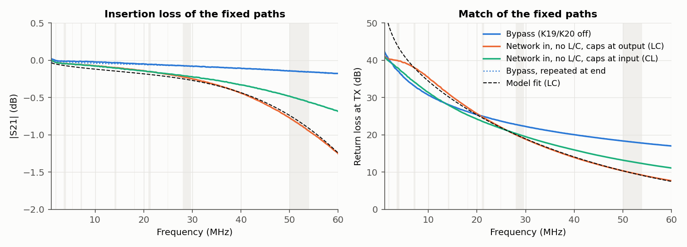
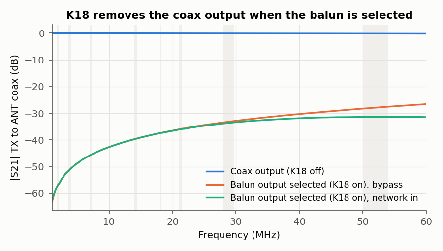
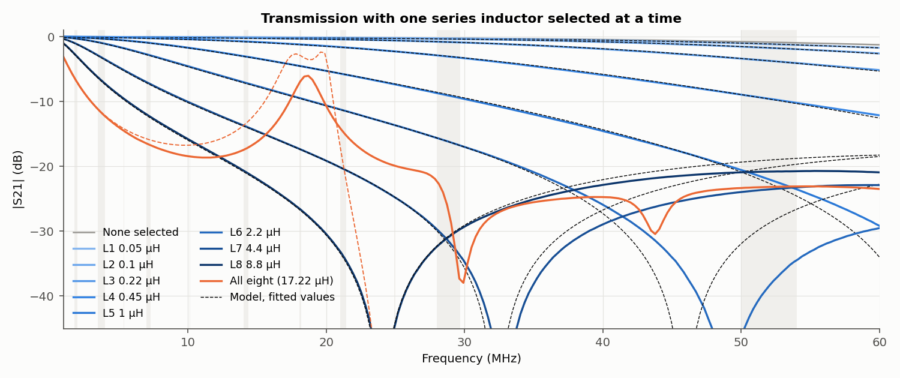
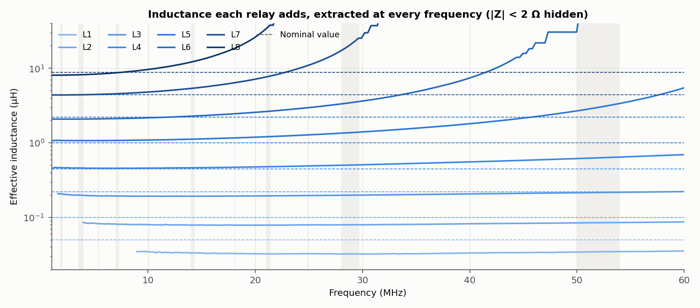
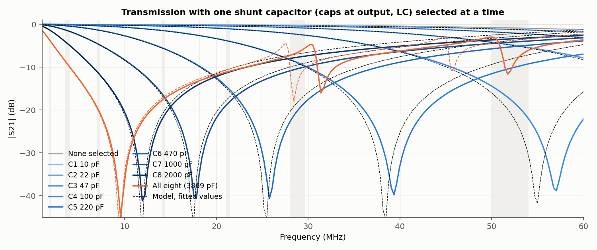
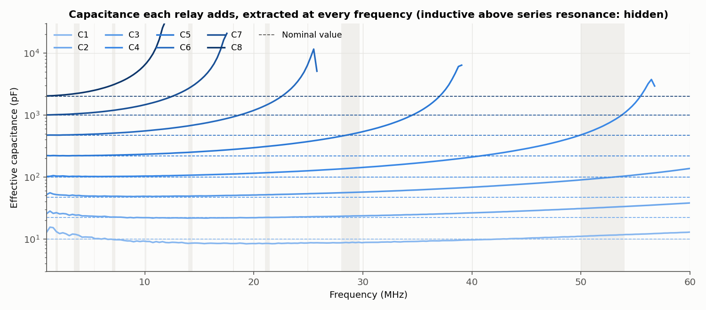
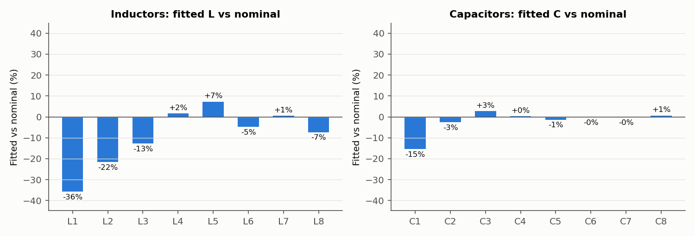
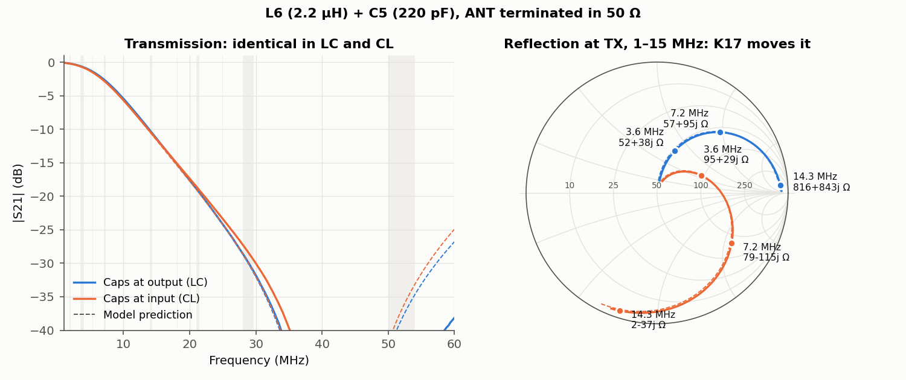
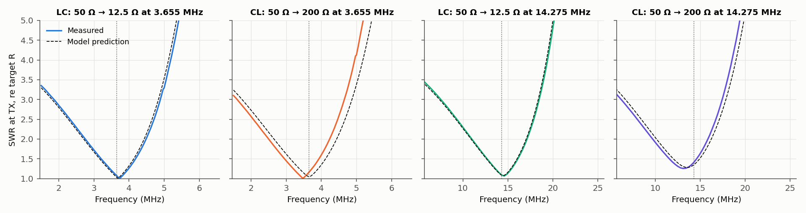

# K9HZ Antenna Tuner: RF Board Characterisation

**Date:** 2026-11-14
**Hardware:** K9HZ 100 W Auto Tuner RF board V2.0 and control board V2.0. Before these tests, the control board's driver-output capacitors C1–C19 were replaced with smaller values: the original 0.1 µF parts tripped the UDN2987 overcurrent latch.
**Instrument:** S-A-A-2 (NanoVNA V2) vector network analyser
**Data and code:** `code/tools/atu_vna/`
**Figures:** `code/docs/atu_rf_characterisation/`

## Summary

All 20 relays switch the RF elements they are meant to, and every element is close to its nominal value:

- **Capacitors:** C2–C8 are within ±3 % of nominal. C1 measures 8.5 pF against 10 pF nominal.
- **Large inductors:** L4–L8 are within −7 % to +7 % of nominal.
- **Small inductors:** L1–L3 add 18–28 nH less than their nominal value. Energising a relay inserts the coil but also removes that relay's own shorting-contact path.
- **Mode relays:**
  - K17 (LC/CL) moves the capacitor bank from one side of the inductors to the other: S21 is unchanged and S11 moves.
  - K18 (balanced output) disconnects the coax output.
  - K19/K20 bypass the network.

I fitted a circuit model to the single-element sweeps. With it I chose relay settings that transform the 50 Ω termination on ANT into 12.5 Ω and into 200 Ω at TX, at 3.65 MHz and 14.28 MHz.

| Setting | Measured SWR (vs target) | Model's SWR | Dissipative loss |
|---|---|---|---|
| LC, 3.65 MHz, 12.5 Ω | 1.07 | 1.03 | 0.21 dB |
| CL, 3.65 MHz, 200 Ω | 1.16 | 1.05 | 0.09 dB |
| LC, 14.28 MHz, 12.5 Ω | 1.09 | 1.09 | 0.31 dB |
| CL, 14.28 MHz, 200 Ω | 1.41 | 1.35 | 0.20 dB |

The ATU works as an L-network tuner. Four parasitics, all quantified below, change how the tuning firmware should treat it above about 7 MHz:

1. **Stray capacitance at the capacitor node.** The bank adds about 56 pF even with every capacitor relay off. That is more than C1 and C2 together (32 pF) and close to C1–C3 together (79 pF).
2. **Capacitor lead inductance.** Each capacitor has 80–90 nH in series with it, 64 nH of it shared by the whole bank. The large capacitors therefore resonate inside HF: C8 at 11.9 MHz, C7 at 17.8 MHz, and all eight together at 9.6 MHz.
3. **Inductor self-resonance.** L8 resonates at 24 MHz, L7 at 33 MHz and L6 at 49 MHz.
4. **Path length.** The fixed paths add about 4.2 ns of delay when the network is in line. On 6 m this costs 0.8 dB and limits the return loss to 10 dB, even with no L or C selected.

**Tuning (§6, simulated).** An SWR reading alone can't identify the right setting, because SWR has no phase. The firmware can still find it with SWR readings only:
1. Read SWR at four known probe settings and estimate the antenna impedance from them.
2. Jump to the setting that stays good even if the model is slightly wrong ("robust selection").
3. Check the result and re-estimate if needed.

In simulation this tunes builds whose hand-wound coils differ by 5 % from this one to near their best possible SWR in a median of five readings. On 80–20 m it comes within 0.15 of the best possible SWR without any per-build calibration. On 10 m calibrating the coils helps, and choosing settings that tolerate model error is essential: picking the best-scoring setting instead gives a median SWR of 1.78 on another build.

## 1. Measurement setup

| Item | Detail |
|---|---|
| VNA | S-A-A-2 (NanoVNA V2, hardware rev 2, firmware 1.1), driven through the saav2 MCP server |
| Port 1 | RF board J1 (RF INPUT, the transmitter side, "TX") |
| Port 2 | RF board J2 (RF OUTPUT, the antenna side, "ANT"), terminated in the VNA's 50 Ω |
| Cables | The "blue" pair used for the calibration |
| Calibration | `hf_1-60M_blue12`: open, short, load and thru with ideal standards, at the cable ends. 1–60 MHz, 201 points, 4× averaging, made 2026-10-31 (13.6 days before these tests) |
| Sweeps | 1–60 MHz, 201 points (295 kHz steps), 4× averaging, about 17 s each. Two extra 1.5–6.5 MHz sweeps at 25 kHz steps for the 80 m matches, with error terms interpolated from the calibration |
| Stimulus | The VNA's normal output, about −10 to 0 dBm. This is a small-signal test only |
| Relay control | Teensy 4.1 running `code/src/BoardTest/TestATUBoard`, with the control board on the BANDS connector (Wire2). `code/tools/atu_vna/atu.py` sends the menu commands over USB serial and checks that the register value matches the I/O-expander readback. Every setting matched |
| Board power | 12 V to the control board, J11 |

The S-A-A-2 measures S11 and S21 only. S22 and S12 were not measured, so the model relies on the network being reciprocal.

### VNA warm-up and drift

The VNA's USB port appeared at 07:08, which is the best estimate of when it was switched on. The table tracks bypass |S21| at 1 MHz while it warmed up; a passive path can't exceed 0 dB.

| Time | Bypass \|S21\| at 1 MHz |
|---|---|
| 07:13 | +0.26 dB |
| 07:20 | +0.16 dB |
| 07:28 | +0.08 dB |
| 07:38 | +0.01 dB |

The data set was taken from 07:39 to 07:56, with bypass measured at the start and again at the end. Between those two, S21 changed by at most 0.053 dB and S11 by at most 0.0006 (linear). Above 10 MHz every bypass reading, from the first warm-up sweep to the last, was within 0.05 dB. The calibration was not re-checked against standards because the ATU was connected throughout. The bypass path's return loss of 40 dB at 2 MHz and its |S21| of 0.00 ± 0.03 dB put an upper bound on the residual calibration error at low frequency.

## 2. Method

**Settings measured.** The data set is 32 sweeps:
- bypass, at the start and the end
- the network in line with no L or C, in both LC and CL positions
- the balun output, both bypassed and with the network in line
- each inductor alone, then all eight
- each capacitor alone (LC), then all eight
- L6 + C5 in both LC and CL
- the four matching settings
- the two fine 80 m re-sweeps

**Why a model is needed.** The fixed RF paths behave as transmission lines, not as zero-length wires. Bypass alone delays the signal by 1.7 ns. So a single element can't be read off S21 with the usual "series Z" or "shunt Y" formula; doing so gives negative resistances. Instead I fitted a cascade (ABCD) model to S11 and S21 together:

- **Zero network** (network in line, nothing selected): line A, then a shunt stray at the capacitor node, then line B. This is fitted separately for LC and CL.
- **Inductor n:** a π section placed at a fitted delay from TX:
  - in series, (R + jωL) in parallel with Cp
  - Cg/2 to ground at each end, for the winding-to-ground-plane capacitance
- **Capacitor n:** a shunt branch at the node, R + jωL_lead + 1/(jωC).
  - The lead inductance comes from single-capacitor sweeps, so it is the whole path.
  - The part shared by the bank, L_sh, is fitted to the all-capacitor sweep.
- **Fit range:** each element is fitted only below 75 % of its first resonance, where a lumped model holds.

The model then predicts settings it was not fitted to: all eight L, all eight C, L6 + C5 in LC and CL, and the four matching settings.

Sections 3.3 and 3.4 also give a frequency-by-frequency view, "effective L" and "effective C" (Figures 4 and 6). At each frequency I solved for the single series impedance (or shunt admittance) that reproduces the measured S21 inside the fitted fixed paths.

## 3. Results

### 3.1 Fixed paths: bypass and the empty network



*Figure 1. Bypass (K19/K20 off), and the network in line with no L or C selected in both K17 positions. The dashed black line is the model fitted to the LC case. Grey bands are the amateur bands.*

| Band | Bypass \|S21\| | Bypass RL | Empty network, LC: \|S21\| | LC: RL | Empty network, CL: \|S21\| | CL: RL |
|---|---|---|---|---|---|---|
| 160 m (1.89 MHz) | −0.00 dB | 40.1 dB | −0.03 dB | 40.3 dB | −0.03 dB | 39.8 dB |
| 80 m (3.65) | −0.01 | 37.2 | −0.05 | 39.9 | −0.05 | 38.0 |
| 40 m (7.20) | −0.02 | 33.0 | −0.06 | 37.9 | −0.06 | 34.1 |
| 20 m (14.28) | −0.04 | 28.0 | −0.10 | 30.9 | −0.11 | 27.9 |
| 15 m (21.06) | −0.06 | 25.0 | −0.15 | 24.8 | −0.15 | 23.6 |
| 10 m (28.43) | −0.08 | 22.6 | −0.23 | 19.7 | −0.21 | 20.1 |
| 6 m (50.85) | −0.15 | 18.2 | −0.81 | 10.1 | −0.50 | 13.0 |

**Bypass** is a nearly transparent path: 1.7 ns long, less than 0.2 dB loss and better than 17 dB return loss everywhere up to 60 MHz.

**The empty network** routes through K19, the eight shorted inductor positions, K20 and K18. It is 5.9 ns long, about 4.2 ns more than bypass. The fitted model for the LC case has:
- a 60 Ω, 3.3 ns input section
- a **56 pF stray** at the capacitor node, in series with 9 nH
- a 95 Ω, 0.7 ns output section

It matches the measurement with a residual of 0.004 in S11 and 0.004 in S21. The stray comes from the bank bus and the open contacts of K9–K17. It sets the smallest shunt capacitance the tuner can present: about 56 pF, more than C1 and C2 together (32 pF). The smallest capacitor steps can only fine-tune on top of it.

### 3.2 Balanced output relay K18



*Figure 2. With K18 energised the RF goes to the balun, and the coax output (where VNA port 2 is connected) is disconnected.*

With the balun selected, the coax port is isolated by 57 dB at 1.9 MHz, falling to 40 dB at 14 MHz, 33 dB at 28 MHz and 28 dB at 51 MHz. Isolation falls by 6 dB per octave, which is the signature of capacitance across K18's open contact. The balun output was left unterminated in these tests, so S11 is close to total reflection. **K18 works as intended.**

### 3.3 Series inductors K1–K8



*Figure 3. Each inductor selected alone (solid lines) against the fitted model (dashed lines). The orange curves are all eight together, measured and predicted.*



*Figure 4. The inductance each relay adds, extracted at every frequency. Dashed lines are the nominal values. Points where the element's impedance is below 2 Ω are hidden, because the VNA can't resolve them.*

| Relay | Nominal (µH) | Fitted L (µH) | Error | Cp (pF) | Cg (pF) | Self-resonance (MHz) | Residual S11 / S21 |
|---|---|---|---|---|---|---|---|
| K1 (L1) | 0.05 | 0.032 | −36 % | 14.9 | 0.3 | > 60 | 0.005 / 0.003 |
| K2 (L2) | 0.10 | 0.078 | −22 % | 8.8 | 0.1 | > 60 | 0.005 / 0.003 |
| K3 (L3) | 0.22 | 0.192 | −13 % | 5.5 | 0.0 | > 60 | 0.006 / 0.004 |
| K4 (L4) | 0.45 | 0.458 | +2 % | 5.8 | 0.0 | > 60 | 0.007 / 0.006 |
| K5 (L5) | 1.0 | 1.073 | +7 % | 5.8 | 0.0 | ≈ 64 (fitted) | 0.008 / 0.006 |
| K6 (L6) | 2.2 | 2.096 | −5 % | 5.7 | 0.0 | 49.1 (measured) | 0.010 / 0.004 |
| K7 (L7) | 4.4 | 4.423 | +1 % | 5.5 | 5.7 | 32.9 (measured) | 0.012 / 0.007 |
| K8 (L8) | 8.8 | 8.158 | −7 % | 5.4 | 20.7 | 24.0 (measured) | 0.012 / 0.010 |

- **Every relay inserts its coil.** L4–L8 are within ±7 % of nominal, which is within the tolerance expected of hand-wound toroids.
- **L1–L3 fall short by 18–28 nH.** A de-energised relay shorts its coil through its normally-closed contact, and that path has inductance of its own. Energising the relay replaces that path with the coil, so the *step* is the coil minus the contact path. This matters most for the smallest steps: L1 adds 32 nH, not 50 nH.
- **Cp is about 5.5 pF on every coil.** Most of it is probably the open contact plus the winding. It sets the self-resonances: L8 at 24 MHz, L7 at 33 MHz and L6 at 49 MHz. By 75 % of its self-resonance a coil's effective inductance has more than doubled, and above it the coil acts as a capacitor. That puts the practical limit at about 18 MHz for L8, 25 MHz for L7 and 37 MHz for L6.
- **Element positions follow the board layout.** The fitted delays rise steadily from 0.9 ns (L1) to 3.3 ns (L7, L8), which matches the chain running L1 → L8 from input to output.
- **All eight in series.** The model predicts the measurement well below 12 MHz, with residuals of 0.06 in S11 and 0.04 in S21 from 1 to 15 MHz. Above that the eight self-resonances interact and the prediction departs from the measurement. The 17 µH setting only makes sense on 160 m, where the input impedance measures 71 + j225 Ω at 1.89 MHz. That implies 19 µH including the path.

### 3.4 Shunt capacitors K9–K16



*Figure 5. Each capacitor selected alone, with the bank at the output (LC), against the fitted model. Orange is all eight, measured and predicted using the 64 nH shared bank inductance.*



*Figure 6. The capacitance each relay adds, extracted at every frequency. It rises towards each capacitor's series resonance and is hidden above it, where the branch is inductive.*

| Relay | Nominal (pF) | Fitted C (pF) | Error | L_lead (nH) | Series resonance (MHz) | R (Ω) | Residual S11 / S21 |
|---|---|---|---|---|---|---|---|
| K9 (C1) | 10 | 8.5 | −15 % | (275)* | > 60 | (5.9)* | 0.005 / 0.003 |
| K10 (C2) | 22 | 21.4 | −3 % | (147)* | > 60 | (1.7)* | 0.005 / 0.004 |
| K11 (C3) | 47 | 48.3 | +3 % | 98 | > 60 | 0.65 | 0.007 / 0.006 |
| K12 (C4) | 100 | 100.3 | +0 % | 84 | 57.1 | 0.25 | 0.006 / 0.005 |
| K13 (C5) | 220 | 217.1 | −1 % | 79 | 39.4 | 0.10 | 0.005 / 0.004 |
| K14 (C6) | 470 | 468.9 | −0 % | 84 | 25.8 | 0.07 | 0.005 / 0.004 |
| K15 (C7) | 1000 | 997.6 | −0 % | 84 | 17.8 | 0.05 | 0.005 / 0.004 |
| K16 (C8) | 2000 | 2012 | +1 % | 90 | 11.9 | 0.06 | 0.004 / 0.004 |
| All eight | 3869 | | | 64 shared | 9.55 | | |

\* C1 and C2 resonate above 60 MHz, so the sweep can't tell their lead inductance and resistance apart. Their capacitance is still well determined.

- **Every relay connects its capacitor.** C2–C8 are within 3 % of nominal. C1 measures 8.5 pF, which is close to the resolution limit for a shunt element against 50 Ω.


*Figure 7. Fitted element values against nominal, for every inductor and capacitor.*

- **Each capacitor has 80–90 nH in its path to ground.** 64 nH of that is shared by the whole bank. I found the sharing because the all-eight sweep resonates at 9.55 MHz: modelling 3.87 nF with eight independent 85 nH leads would put that resonance much higher. With a shared 64 nH the model lands the all-eight notch exactly and predicts the sweep with a residual of 0.004–0.006 below 15 MHz. The shared part is most likely K17 and the bank bus.
- **Consequence:** the effective capacitance rises steeply with frequency (Figure 6).
  - At 14 MHz C8 already acts as an inductor.
  - At 28 MHz C5 behaves like about 470 pF and C6 is inductive.
  - Above about 7 MHz the tuning firmware should therefore use the measured branch admittances, not the nominal values.
  - On 10 m only C1–C5 are useful (C5 already acts as about twice its value). On 6 m only C1–C3 stay close to nominal, and C4 is near its 57 MHz resonance.

### 3.5 Capacitor position relay K17 (LC versus CL)



*Figure 8. L6 (2.2 µH) and C5 (220 pF) with the capacitor at the output (LC) and at the input (CL). The left panel shows transmission; the right panel shows the impedance at TX on a Smith chart, with ANT terminated in 50 Ω. Dashed lines are the model's predictions; neither setting was used in the fit.*

Moving the capacitor bank should leave S21 unchanged, since a reciprocal network has the same S21 in both directions. It should only change the impedance seen at TX:

| | LC | CL |
|---|---|---|
| Expected Zin | jωL + (50 ∥ Z_C) | Z_C ∥ (jωL + 50) |
| Measured at 3.6 MHz | 52 + j38 Ω | 95 + j29 Ω |
| Measured at 7.2 MHz | 57 + j95 Ω | 79 − j115 Ω |
| Measured at 14.3 MHz | 816 + j843 Ω | 2 − j37 Ω |

The two S21 curves agree within 0.25 dB up to 20 MHz, where |S21| is already −17 dB. By 30 MHz (|S21| ≈ −30 dB) the difference grows to 1.8 dB, because the two routes through the board are not identical. **K17 works.**

How well the model predicts these:
- **LC:** residual 0.008–0.010 in S11 at all frequencies.
- **CL:** residual 0.04 in S11 below 15 MHz, but 0.19 from 15 to 30 MHz.

The CL fit uses the same element positions mapped into a differently routed path, so it is less accurate there.

### 3.6 Impedance transformation



*Figure 9. SWR at TX relative to the target resistance, measured (solid) and predicted (dashed), for settings the model chose by searching all 65,536 L/C combinations. The dotted vertical line marks the design frequency. The 80 m panels use the fine 25 kHz re-sweeps.*

A tuner's job is to transform impedance. In this setup ANT is always terminated in 50 Ω, so I chose settings that turn that 50 Ω into 12.5 Ω or 200 Ω at TX: a 4:1 transformation each way. For a lossless network the same setting also does the reverse: a source of 12.5 Ω or 200 Ω at TX sees 50 Ω at ANT.

**Relay settings (nominal values):**

| Target | L selected | C selected |
|---|---|---|
| LC, 3.65 MHz, 12.5 Ω | L2+L3+L4 = 0.77 µH | C1–C5 + C7 = 1399 pF |
| CL, 3.65 MHz, 200 Ω | L1–L6 = 4.02 µH | C4+C5 = 320 pF |
| LC, 14.28 MHz, 12.5 Ω | L1 = 0.05 µH | C2+C3+C5 = 289 pF |
| CL, 14.28 MHz, 200 Ω | L5 = 1.0 µH | C2 = 22 pF |

**Results:**

| Target | Predicted Zin | Measured Zin | SWR at f0: measured / model | Best measured SWR | Dissipative loss |
|---|---|---|---|---|---|
| LC, 3.65 MHz, 12.5 Ω | 12.7 − j0.3 | 12.8 − j0.8 | 1.07 / 1.03 | 1.01 at 3.725 MHz | 0.21 dB (95 %) |
| CL, 3.65 MHz, 200 Ω | 191.7 − j3.8 | 209.6 − j28.8 | 1.16 / 1.05 | 1.01 at 3.475 MHz | 0.09 dB (98 %) |
| LC, 14.28 MHz, 12.5 Ω | 12.0 − j0.9 | 12.2 − j1.1 | 1.09 / 1.09 | 1.06 at 14.57 MHz | 0.31 dB (93 %) |
| CL, 14.28 MHz, 200 Ω | 268.3 − j9.6 | 270.2 − j38.2 | 1.41 / 1.35 | 1.26 at 13.10 MHz | 0.20 dB (95 %) |

Dissipative loss is −10 log₁₀(|S21|² / (1 − |S11|²)). This separates the power actually lost in the network from the mismatch loss you'd expect from a 4:1 transformation, about 1.9 dB.

- **Both LC settings are predicted closely,** within 0.6 Ω.
- **Both CL settings land within 10 % in resistance** but carry about 25–30 Ω more capacitive reactance than predicted. This matches the CL S11 error found in §3.5.
- **On 80 m the CL match is real but sits 175 kHz lower than designed:** SWR 1.01 at 3.475 MHz.
- **The 20 m step-up to 200 Ω can't be reached exactly by any setting.** The search's best prediction was SWR 1.35, and the board measured 1.41. The model places the CL capacitor node about 1.7 ns of path from the TX connector. At 14 MHz that length rotates a high impedance appreciably before the network can act on it.
- **Dissipative loss is 0.1–0.3 dB** in every case, so the coils and relay contacts are not lossy at these settings.

## 4. Assessment against expectations

| Expectation | Result |
|---|---|
| Each of K1–K8 inserts its inductor | **Yes.** L4–L8 within ±7 %; L1–L3 add 18–28 nH less than nominal (relay contact path) |
| Each of K9–K16 connects its capacitor | **Yes.** C2–C8 within ±3 %; C1 −15 % |
| Binary weighting gives a monotonic L and C ladder | **L: yes** (steps of 0.03 to 8.2 µH). **C: yes at low frequency**, but the 56 pF stray, and the lead inductance above about 7 MHz, change the effective ladder |
| K17 moves the bank without changing S21 | **Yes.** S21 matches within 0.25 dB to 20 MHz; Zin moves as an L network should |
| K18 diverts the output to the balun | **Yes.** The coax port is isolated by 57 dB at 1.9 MHz and 28 dB at 51 MHz |
| K19/K20 bypass the network | **Yes.** Bypass loses less than 0.2 dB with return loss above 17 dB to 60 MHz |
| The network can match 4:1 both ways on 80 m and 20 m | **Yes,** apart from the 20 m step-up: best measured SWR 1.26 (1.41 at the design frequency) |
| The network has low loss | **Yes.** 0.1–0.3 dB dissipated at the matched settings; 0.03–0.18 dB in the empty network below 30 MHz |

## 5. Implications for the tuning firmware

1. **Use measured element models, not nominal values.**
   - `code/tools/atu_vna/fits.json` holds every fitted parameter.
   - `model.predict()` computes S11 and S21 for any setting in either topology.
   - Above about 7 MHz the nominal-value model is wrong by more than a relay step for the large capacitors. On 20 m and above it is wrong for L7 and L8.
2. **Restrict elements by band.** Taking 75 % of each element's measured resonance as its practical limit:
   - **Capacitors:** C8 about 9 MHz, C7 about 13 MHz, C6 about 19 MHz, C5 about 30 MHz.
   - **Inductors:** L8 about 18 MHz, L7 about 25 MHz, L6 about 37 MHz.
   - **On 6 m:** only L1–L4 and C1–C3 behave close to their nominal values. L5 and C4 are near resonance, and L6 is past it.
3. **Treat about 56 pF as the minimum shunt capacitance** in the LC topology, and allow for about 4 ns of path when the network is in line. Both limit how high an impedance can be matched on 10 m and 6 m.
4. **Prefer bypass when the load is already a good match.** On 6 m the empty network alone costs 0.8 dB and limits the return loss to 10 dB.
5. **A search plus this model reproduces the measured matches,** within about 0.1 SWR in LC and 0.15 SWR in CL at 80 m and 20 m. `design.py` is a working, if brute-force, example. Section 6 builds this into a complete tuning algorithm.

## 6. Tuning algorithm

This section asks two questions:

1. Given a good measured model of the ATU, can firmware go straight to the best relay setting from an SWR reading at one frequency?
2. Will that still work on another build, whose hand-wound inductors will differ from this one's?

It then proposes an algorithm that does work on another build, using only the T41's magnitude-only SWR bridge.

All results in this section are simulations. They use the circuit model fitted in §2–3, which reproduces the measured board to within 0.01 in S11 and S21 for the LC topology. `code/tools/atu_vna/tuning_sim.py` produces every number; its saved outputs are `sim_*.txt` in the same folder.

### 6.1 How the simulation works

The model gives every relay setting as a full two-port: 256 L codes × 256 C codes × 2 topologies, 131,072 settings in all. With an antenna Z_ant on ANT, the impedance at TX is Zin = (A·Z_ant + B)/(C·Z_ant + D). Evaluated for all settings at once, finding the best setting takes milliseconds.

| Assumption | Value |
|---|---|
| Antenna loads | Spread evenly over the Smith chart out to SWR 10 (\|Γ\| ≤ 0.82). This goes beyond the tuner's 35–1200 Ω specification, so includes loads it was never meant to match |
| Frequencies | 3.65, 7.1, 14.2 and 28.4 MHz |
| "Other builds" | Each coil's L and Cp drawn independently with σ = 5 %. That is the scatter of L4–L8 about nominal on this board. Layout parasitics (bank stray, lead inductances, path delays) are assumed the same on every build of this PCB; not yet verified on a second board |
| SWR bridge | Measures \|Γ\| only, no phase, with 3 % relative random error per reading. No systematic error |

### 6.2 A single SWR reading cannot identify the setting

SWR fixes only |Γ|. Every impedance on a circle around 50 Ω on the Smith chart reads the same SWR, and those impedances need entirely different settings. Here are four antennas that all read **SWR 3.0 at 7.1 MHz**:

| Z_ant | Best setting | SWR after tuning |
|---|---|---|
| 150 + j0 Ω | LC, L code 23, C code 11 | 1.07 |
| 16.7 + j0 Ω | CL, L code 15, C code 43 | 1.19 |
| 30 + j40 Ω | LC, L code 15, C code 32 | 1.17 |
| 30 − j40 Ω | CL, L code 16, C code 28 | 1.28 |

Even the capacitor position differs between them. **Going straight to the right setting needs the complex reflection coefficient: magnitude and phase.** With that and a good model the best setting is computed directly. The T41's bridge only gives magnitude, so the rest of this section works with that.

### 6.3 Using one build's model on another build

Suppose Z_ant is known exactly. I chose the setting using *this* board's model and applied it to builds with different coils:

| Band | Best possible on that build (median / 90 % / max) | This board's model on another build (median / 90 % / max) |
|---|---|---|
| 80 m | 1.04 / 1.34 / 1.61 | 1.10 / 1.37 / 1.70 |
| 40 m | 1.08 / 1.59 / 2.31 | 1.13 / 1.68 / 2.34 |
| 20 m | 1.21 / 2.08 / 3.11 | 1.24 / 2.10 / 3.12 |
| 10 m | 1.02 / 1.04 / 1.07 | **1.78 / 2.99 / 5.36** |

- **On 80, 40 and 20 m** another board's model is good enough.
- **On 10 m it fails.** There the best-scoring settings rely on elements near or past resonance:
  - L7 at 0.86 of its self-resonance
  - C7 and C8 above their series resonance, where they act as inductors

  Those settings give excellent coverage on the model of this board. But near resonance a small change in L or Cp swings the reactance a long way, so they don't carry over to another build.
- **More calibration accuracy alone doesn't fix 10 m.** Even with every coil known to 1 %, the median SWR on 10 m rises from 1.05 to 1.17 (90th percentile 1.61). On 40 m and 20 m even a 5 % error changes nothing measurable.
- **The inductor ladder isn't evenly stepped, and its steps differ per build.** On this board:
  - L8 alone (8.16 µH) is *less* than L1–L7 together (8.35 µH), so relay code 128 gives less inductance than code 127.
  - There are holes between neighbouring codes: 0.49 µH between codes 63 and 64, and 0.31 µH between 15 and 16.
  - Another build will have its overlaps and holes in different places.
  - Hill-climbing in sorted-inductance order instead of binary-code order made no difference in the simulation, so the firmware can step in binary code. But it must not assume that inductance is proportional to the code.

### 6.4 Choosing a setting that tolerates model error ("robust selection")

The fix for 10 m is to choose settings that stay good if the model is slightly wrong, not just the best-scoring one:
1. Take the 300 best settings according to the model.
2. Evaluate each against 6 copies of the model with the coils perturbed by 2 %.
3. Keep the setting whose *worst* \|Γ\| across those copies is lowest.

Known Z_ant, setting applied to other builds with σ = 5 %:

| Band | Plain best | Elements restricted to below 60 % of resonance | Robust selection |
|---|---|---|---|
| 80 m | 1.09 / 1.39 / 1.60 | 1.09 / 1.39 / 1.60 | 1.09 / 1.39 / 1.60 |
| 40 m | 1.13 / 1.83 / 2.13 | 1.13 / 1.83 / 2.13 | 1.14 / 1.84 / 2.53 |
| 20 m | 1.26 / 1.99 / 3.64 | 1.26 / 1.99 / 3.64 | 1.26 / 1.99 / 3.63 |
| 10 m | 1.38 / 1.76 / 7.33 | 1.54 / 2.58 / 6.40 | **1.09 / 1.14 / 1.15** |

- **Robust selection solves 10 m** at no cost on the other bands.
- **Simply banning near-resonant elements is worse** on 10 m, because it throws away coverage.
- **The 20 m tail is a coverage limit, not a model error.** The 90th-percentile SWR of about 2.0 and the maximum of 3.6 are the best any setting can do for those loads, on this board or any other. The holes in the ladders and the stray capacitance cause it. It should be checked with real loads, since many of the worst simulated loads lie outside the 35–1200 Ω specification.

### 6.5 Proposed algorithm

The design combines:
- a model of the ATU stored in firmware: the parameters in `fits.json` from this report, optionally with a per-build inductor calibration
- a few SWR readings at known "probe" settings, used to estimate Z_ant
- a jump to the robust best setting for that estimate
- a check against the model's prediction, which folds each new reading back into the estimate
- an optional short hill-climb to finish

```
TUNE(f):
  0. Memory:   if a setting is stored for this antenna near f
                 -> apply it, read SWR; if within 0.1 of the stored SWR, done.
  1. Bypass:   read SWR with the network bypassed; if SWR <= 1.3, stay bypassed.
  2. Probe:    read |Γ| at 4 fixed settings (relays switched with RF off):
                 P1 network in, nothing selected (LC)
                 P2 one series L whose reactance at f is closest to 50 Ω
                 P3 one shunt C whose susceptance at f is closest to 1/50 S
                 P4 that L and C together, CL topology
  3. Estimate: find Z_ant = R + jX (R > 0) that best explains all readings so far:
                 minimise Σ (|Γ_model(setting_k, Z_ant)| - |Γ_measured,k|)²
                 over several starting points (R in {10, 50, 300, 1000}, X in ±{0, 50, 300}).
  4. Jump:     search all 131,072 settings for this Z_ant; take the 300 best and pick
               the one with the lowest worst-case |Γ| over 6 copies of the model with
               coils perturbed by 2 %; apply it and read |Γ|.
  5. Accept:   if SWR <= target (1.5) or |Γ| <= predicted |Γ| + 0.05, accept.
               Otherwise add this reading to the set and go back to 3
               (at most 4 jumps; then fall back to a hill-climb from the best so far).
  6. Polish (optional): if the accepted SWR > 1.2, hill-climb on the L and C codes
               (steps of ±1 and ±2) until no neighbour reads better.
  7. Store:    save (antenna, f, topology, L code, C code, SWR, Z_ant estimate).
```

**Notes on each step**

- **Probes (step 2).** Each probe transforms the unknown antenna impedance by a known network, so each reading puts Z_ant on a known circle. Probes 2 and 3 rotate that circle in opposite directions, which removes the ambiguity a single reading leaves. A probe whose element is near resonance gives little information, so the probe elements are chosen per band from the model, not fixed.
- **Re-estimating after a jump (steps 3–5).** Folding each jump's own reading back into the estimate matters. In the simulation, solving once from the four probes occasionally converged on the wrong impedance and gave SWR as high as 16. Re-solving with the jump's reading included removed every such failure.
- **Acceptance (step 5).** The rule accepts a setting that is as good as the model says this load can be matched, so it doesn't keep searching for a match the hardware can't reach.
- **Power and relays.** Tune at low power, and switch relays only with the carrier off; hot-switching was not tested and would shorten contact life. Each reading costs a relay operate-and-settle time (the HF41F datasheet's figure; allow about 10 ms), plus carrier key-up and a bridge read. If every probe reads |Γ| close to 1, abort and report an antenna fault rather than tuning into an open or short.
- **Firmware structure.** Run tuning as a state machine in the style of `HardwareSm`. Each loop pass does one relay change or one reading, so the 10 ms main-loop budget holds.
- **Computation.** For a given frequency, precompute the 256 inductor-path matrices and 256 bank admittances, about 10 kB. Each of the 131,072 combinations then takes about 30 complex multiplies, roughly 15 MFLOP per search. On the Teensy's Cortex-M7 that is an estimated tens of milliseconds; I haven't benchmarked it. It can be split across loop passes, or replaced by an analytic L-network solution followed by a local search over neighbouring codes.

**Simulated performance, end to end.** Other builds with σ = 5 % coils, SWR readings with ±3 % error, 40 loads up to SWR 10. Each cell gives median / 90th percentile / max SWR.

| Band | Best possible | Jump only: this board's model | Jump only: model calibrated to 2 % | Jump + polish: calibrated | SWR readings, jump only, this board's model (median / max) | SWR readings, jump + polish, calibrated (median / 90 %) |
|---|---|---|---|---|---|---|
| 80 m | 1.03 / 1.26 / 1.84 | 1.17 / 1.38 / 1.86 | 1.19 / 1.31 / 1.85 | 1.11 / 1.26 / 1.88 | 5 / 6 | 5 / 37 |
| 40 m | 1.07 / 1.70 / 2.04 | 1.17 / 1.72 / 2.04 | 1.15 / 1.70 / 2.04 | 1.11 / 1.71 / 2.04 | 5 / 7 | 5 / 30 |
| 20 m | 1.27 / 2.06 / 4.14 | 1.28 / 2.07 / 4.16 | 1.30 / 2.06 / 4.14 | 1.27 / 2.06 / 4.22 | 5 / 6 | 12 / 29 |
| 10 m | 1.03 / 1.06 / 1.06 | 1.11 / 1.31 / 1.35 | 1.07 / 1.13 / 1.14 | 1.07 / 1.14 / 1.16 | 5 / 7 | 5 / 5 |

- **Five SWR readings** (four probes and one jump) reach close to the best possible on every band. The fallback hill-climb was never needed in 160 tunes.
- **The answer to question 2 is yes, provided the selection is robust.** Even an *uncalibrated* reference model tunes another build to within 0.15 SWR (median) of its best on 80–20 m, and to 1.11 median (1.35 worst) on 10 m.
- **Calibrating the inductors on each build mainly helps the upper bands:** the 10 m 90th percentile drops from 1.31 to 1.13.
- **Polishing** brings the median within 0.1 of the best on 80 m and 40 m. It costs 30–60 extra readings for the 10 % of loads that need it.

### 6.6 Calibrating each build's inductors with the radio itself

Each build's coils can be measured with the radio itself instead of a VNA:
1. Put a 50 Ω dummy load on ANT.
2. Transmit at low power.
3. Select one coil at a time and read the SWR.
4. Solve the model for the L that reproduces the reading.

With a known 50 Ω load a series reactance gives |Γ| = |X| / √(X² + 100²), so one reading gives one value with no ambiguity. Choose a ham band where the coil's reactance is about 50–100 Ω and well below its self-resonance:

| Coil | Calibrate on | Reactance | f / self-resonance | Expected SWR | L error per 1 % error in \|Γ\| |
|---|---|---|---|---|---|
| L1 | 6 m (50.1 MHz) | 10 Ω | 0.22 | 2.20 | 4.5 % |
| L2 | 6 m | 25 Ω | 0.26 | 2.90 | 2.4 % |
| L3 | 6 m | 60 Ω | 0.32 | 5.67 | 2.3 % |
| L4 | 12 m (24.9 MHz) | 72 Ω | 0.25 | 4.06 | 1.5 % |
| L5 | 30 m (10.12 MHz) | 68 Ω | 0.16 | 3.53 | 1.4 % |
| L6 | 40 m (7.1 MHz) | 93 Ω | 0.15 | 5.19 | 1.8 % |
| L7 | 160 m (1.9 MHz) | 53 Ω | 0.06 | 2.70 | 1.3 % |
| L8 | 160 m (1.9 MHz) | 97 Ω | 0.08 | 5.38 | 1.9 % |

- **L4–L8:** 1–2 % bridge accuracy gives a 1.5–4 % calibration. Averaging many readings removes random error but not systematic bridge error. The T41 bridge's systematic errors (for example the crosstalk between its detector channels) must be corrected first; see `swr_calibration_approach.md`.
- **One possible correction method:** C4–C8 measured within 1 % of nominal on this board, so the capacitor relays could serve as on-board reference standards for checking the bridge at each calibration frequency. That depends on the capacitor tolerance holding from build to build, which I haven't verified.
- **L1 and L2 can't be calibrated well this way.** Even on 6 m their reactance is small next to the fixed path's own mismatch. Keep their reference values, which mostly reflect the PCB layout and relay contact paths.
- **The capacitors and the layout parasitics** would keep their reference values unless a second board shows they vary.
- **Simulation assumes 2 %.** The "calibrated" column in §6.5 assumes the procedure reaches 2 %. With robust selection the result barely depends on it below 10 m.

### 6.7 Limits of this analysis

- **Simulated against a model.** The model is accurate for LC, and less so for CL above 15 MHz (§3.5). Its errors in the CL topology are not represented in the simulation.
- **Only the coils vary between simulated builds.** The fixed paths, stray capacitance, capacitor lead inductances and relay contacts are assumed identical on every build. A second board needs measuring to confirm this.
- **Bridge errors are random only.** Systematic bridge error, detector floor at low reflected power, and the bridge's own frequency response are not modelled.
- **Location of the bridge.** The probe readings must be taken where the ATU's input impedance is seen. I assumed the ATU sits between the LPF board's bridge and the antenna; any cable between them adds a fixed transformation, which the model would need.
- **Not tested on hardware.** Power handling, relay timing, temperature drift of the coils, and real antennas were not tested. The algorithm still needs a hardware trial: the next step is to run steps 2–6 on the bench, with known complex loads on ANT and the VNA used to confirm the result.

## 7. Limitations

- **Small signal only.** The stimulus was below 0 dBm. Power handling, contact heating and arcing at 100 W, and hot-switching were not tested.
- **Calibration age and drift.**
  - The calibration was 13.6 days old and was not re-verified with standards.
  - The VNA had been on for about 35 minutes when the data set started. Section 1 quantifies the residual drift as at most 0.053 dB.
- **One-and-a-half-port measurement.** S22 was not measured, so the model assumes reciprocity, and the output-side match of each setting is inferred, not measured.
- **Frequency resolution.** The 295 kHz steps put only one or two points in 160 m. For the 80 m matches I re-swept at 25 kHz.
- **Equivalent model.** The split of the fixed paths into line sections and a node stray is an equivalent circuit, not a physical layout.
  - The CL path is the least accurate part: errors of 0.04 in S11 below 15 MHz and 0.19 from 15 to 30 MHz.
  - All eight inductors in series are only modelled well below 12 MHz.
- **Balun not tested.** The balanced output (T1, J3/J4) was not measured; only the coax port's isolation was.

## 8. Reproducing

Everything is in `code/tools/atu_vna/`:

| File | Purpose |
|---|---|
| `atu.py` | Sets relay states through the TestATUBoard sketch and checks the readback, e.g. `python3 atu.py ALL0 IN "LM 32" "CM 16"` |
| `data/atu_*.s2p` | Raw sweeps from the saav2 MCP server (S11 and S21; S12 and S22 written as 0) |
| `s2p.py`, `model.py` | Loader and circuit model |
| `analyse.py` | Fits the model, writes `fits.json`, and draws Figures 1–9 into `code/docs/atu_rf_characterisation/` |
| `design.py` | Searches all relay settings for the matching targets and writes `match_plan.json` |
| `tuning_sim.py` | Section 6 simulations. Run it with no argument, or with `extra`, `robust` or `algorithm`; the saved outputs are `sim_main.txt`, `sim_extra.txt`, `sim_robust.txt` and `sim_algorithm.txt` |

To reproduce:

1. Warm the VNA up for at least 30 minutes.
2. Load the `hf_1-60M_blue12` calibration.
3. For each setting, send its relay commands with `atu.py`, then take a 4×-averaged S21 sweep with `save_as=atu_<tag>`.
4. Copy the `.s2p` files into `data/`.
5. Run `analyse.py`, then `design.py`, measure the four `match_*` settings, and run `analyse.py` again.
