# Automatic power and SWR calibration

The automatic calibration performs two steps every band from 160 m to 6 m:

- **The power calibration.** Measures the PA power curve, which makes the radio's power setting accurate in CW, and the SSB gain, which does the same in SSB.
- **The SWR bridge calibration.** This makes the power and SWR readings on the display accurate.

The firmware automates the measurement process as much as possible. You need to fit three components to the antenna connector when prompted: a 50 Ω load, nothing (an open), and a short. If you have an external power meter, you can also enter a few wattmeter readings.

## Which level?

There are three potential levels of calibration. They differ in how much test equipment you need and how accurate the power display is afterwards. All three measure the open and the short in the same way, so the SWR reading is almost equally good at every level.

| Level | Equipment | Wattmeter readings | Power display accuracy |
|---|---|---|---|
| 1 | 50 Ω dummy load, short | none | within about ±1.5 dB |
| **2 (recommended)** | Wattmeter with its 50 Ω load, short | 2 per band (22 in all) | about ±0.3 dB, worst ±0.8 dB |
| 3 | Wattmeter with its 50 Ω load, short | 8 per band (88 in all) | about ±0.2 dB |

**Use level 2 if you have a wattmeter.** It requires only two readings per band and makes the power display several times more accurate than level 1. Level 1 has nothing that measures absolute power, so it relies on typical values from other radios. Level 3 is mainly for development work. It is not described here, but it runs the same way as level 2 with more readings.

You can calibrate at level 1 now and repeat the calibration at level 2 later, when you have a wattmeter. The new results replace the old ones. If you have a wattmeter, go straight to level 2 without doing level 1 first.

### Before you start

- **Use the 20 W PA.** The automatic calibration runs with the 20 W PA only. The 100 W PA is not supported yet.
- **Know your L44 turns.** The calibration asks for the number of turns per core on the SWR bridge's coupler, L44. The example screens below assume 20.
- **Let the radio warm up** before you calibrate. A cold radio can read a few tenths of a dB differently.
- **Use the antenna connector you normally operate from.**
- **Fit everything directly on the antenna connector: no cables or adapters.** This matters most for the short. A cable between the connector and the short makes every SWR read high which cannot be corrected for by the calibration.

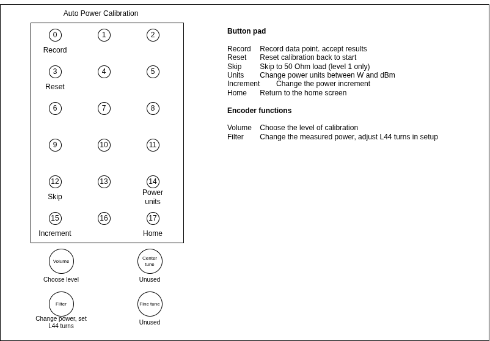

### Controls

| Control | What it does in the automatic calibration |
|---|---|
| Button 1 | Start the automatic calibration (from the manual power calibration screen) |
| SELECT (button 0) | Start; confirm that a standard is fitted; enter a wattmeter reading; accept the results |
| ZOOM (button 3) | Abort at any time. The radio stops transmitting at once and nothing is stored |
| HOME | Leave calibration |
| Volume encoder | Choose the level (setup screen only) |
| Filter encoder | Set the L44 turns (setup screen); dial in a wattmeter reading |
| Button 12 | Skip the 50 Ω load (level 1 only, see step 5) |
| Button 14 | Switch the wattmeter entry between W and dBm; on the review screen, repeat the failed bands |
| Button 15 | Change the wattmeter entry's step (1, 0.1 or 0.01) |

---

## Level 1 calibration: no wattmeter

### Equipment

| Item | Notes |
|---|---|
| 50 Ω dummy load | Rated for at least 20 W continuous. The radio transmits for about 20 s at a time on each band, up to full power (about 18 W on 80 m). |
| Short | A low-inductance short that screws straight onto the antenna connector, e.g. a shorting plug. |
| Open | Nothing on the connector. |

A whole level 1 session takes about 12 minutes: about 4 minutes on each of the load, the open and the short.

### Step by step

1. Press the menu button, select **Calibration**, then **Power**.

   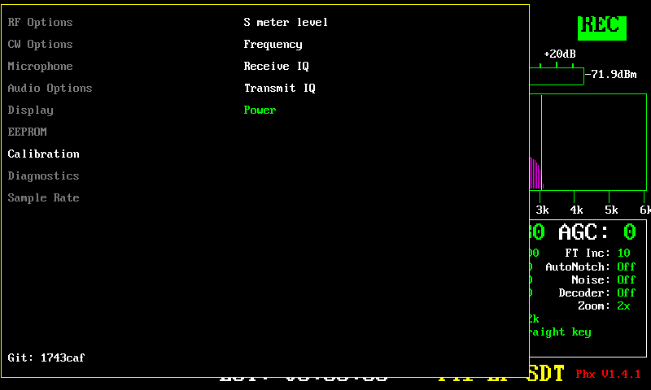

2. The manual power calibration screen appears. Press **button 1** to enter the automatic calibration routine.

   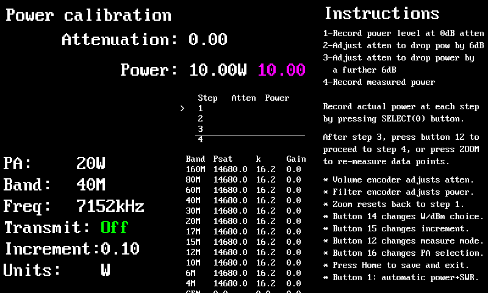

3. On the setup screen, turn the **volume encoder** until the level reads **1**. Turn the **filter encoder** until **L44 turns** shows your radio's turns per core. The radio saves this number, so you only need to set it the first time. Press **SELECT**.

   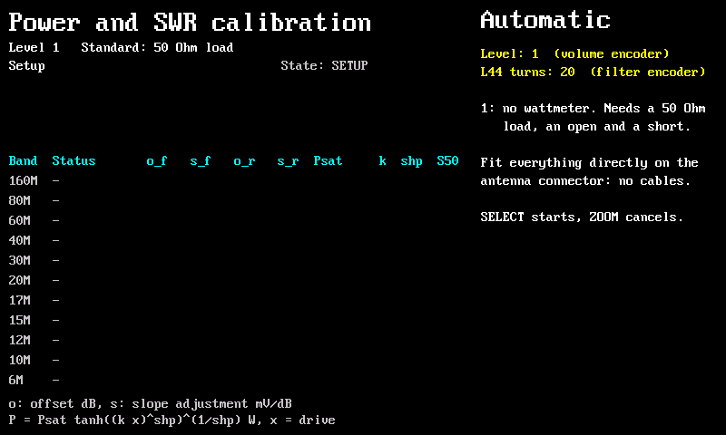

4. The radio asks for the **50 Ω load**. Screw the dummy load onto the antenna connector and press **SELECT**.

   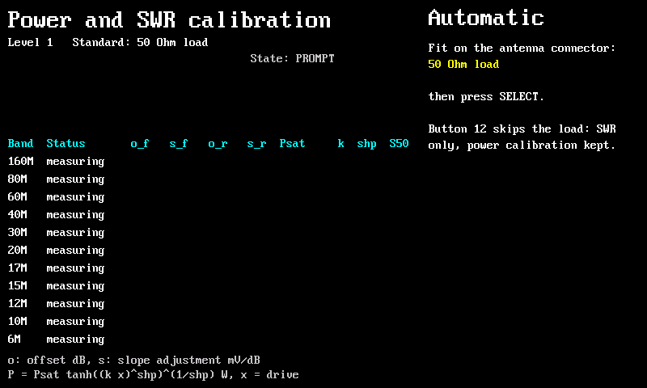

5. *Optional:* To recalibrate only the SWR bridge and keep the existing power calibration, press **button 12** here instead of SELECT. The radio skips the load and goes straight to the open (step 7).

6. The radio now works through every band from 160 m to 6 m without your help. On each band it keys the CW carrier and steps the attenuation from 0 to 31.5 dB (12 points), then sends a short SSB tone. **KEYED** in red means it is transmitting. Leave the connector alone. When a band is done, its forward line (o_f, s_f) and PA curve (Psat, k, shp) appear in the table. In  the example, 160 to 30 m are done and the radio is on point 8 of 13 on 20 m.

   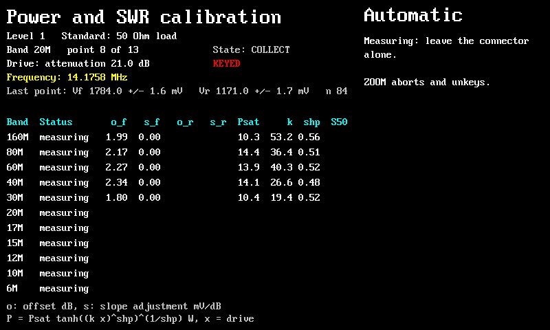

   Press **ZOOM** if anything goes wrong. The radio stops transmitting at once and nothing is stored.

7. After 6 m the radio stops transmitting and asks for the **open**. Remove the dummy load, leave the connector bare, and press **SELECT**.

   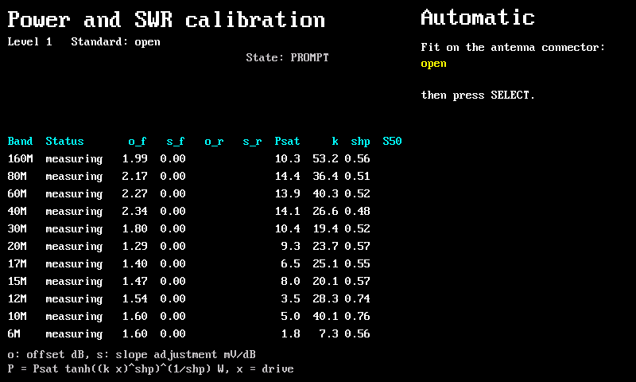

8. The radio measures every band again, this time with six short bursts of SSB tone at falling power, starting at about 1.2 W. Each burst lasts at most 2 seconds, with a second in receive between bursts, so the PA does not overheat into the open. Leave the connector alone.

   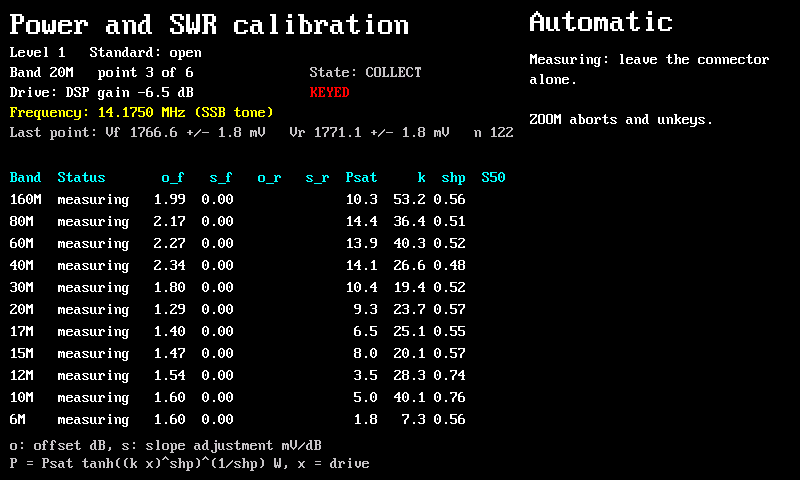

9. The radio asks for the **short**. Screw the short directly onto the antenna connector and press **SELECT**. The radio measures every band again, in the same way as the open.

   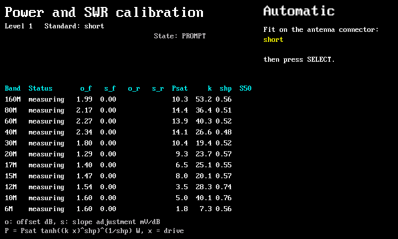

10. When the short is done, the review screen shows the result for every band. Green **pass**  means the band is ready to store. In the example all 11 bands passed:

    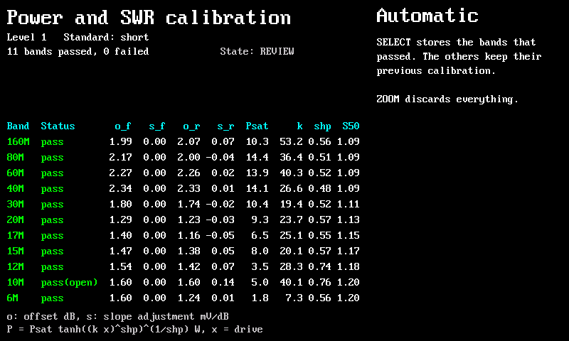

    - **pass(open)** or **pass(shrt)** means the band passed, but its SWR calibration comes from only one of the open and the short. That is slightly less accurate. Sometimes the PA oscillates into a short, which is detected by the firmware and oscillating data points are excluded.
    - A band that failed shows its first reason in red, and the right-hand side lists all the reasons. See [If a band fails](#if-a-band-fails).
    - **S50** is the SWR the bridge read on the dummy load. It should be close to 1. A value above 1.3 (1.5 above 20 MHz) fails the band. Check the load and its connection.

11. Press **SELECT** to store the bands that passed. Bands that failed keep their previous calibration. To throw away the whole session instead, press **ZOOM**.

    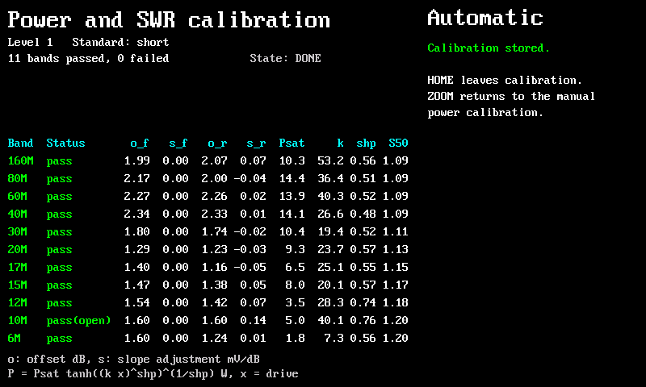

12. Press **HOME** to leave calibration. The radio returns to your band, frequency and mode.

### If a band fails

On the review screen, press **button 14** to repeat the session for the failed bands only. The radio goes back to the setup screen and asks for the load, the open and the short again, but measures only those bands. When they pass, press **SELECT** to store everything.

| Reason on the review screen | What to check |
|---|---|
| 50 Ohm load missing | The dummy load was not fitted, or came loose, during the load stage. |
| load SWR too high | A poor dummy load, or a cable or adapter between it and the connector. |
| open and short abandoned | The PA oscillated into both the open and the short. Check the PA, then retry. |
| too few readings | The SWR bridge readings did not arrive. Check the LPF board and its I²C connection. |
| PA curve fit | The radio could not fit the PA curve, usually because a reading was wrong. Retry. |
| any other reason | Check that the standards are fitted directly to the connector and retry. If the band still fails, use the manual calibration for it. |

---

## Level 2 calibration: two wattmeter readings per band (recommended)

Level 2 runs like level 1, with one addition. On each band, after the attenuation sweep, the radio pauses twice while still transmitting and asks you for the external wattmeter reading: once near 2 W and once at full power.

### Equipment

| Item | Notes |
|---|---|
| Wattmeter with its 50 Ω load | Covers 1.8 to 54 MHz and up to 20 W. It needs to be accurate near 2 W and at full power. A meter that is accurate to ±5 % gives about ±0.2 dB on the power display. Connect the meter to the antenna connector with as short a lead as possible, and put its 50 Ω load on the meter's output. The load must take 20 W continuously. |
| Short | A low-inductance short that screws straight onto the antenna connector. |
| Open | Nothing on the connector. |

Allow about 20 minutes for a level 2 session.

### Step by step

1. Press the menu button, select **Calibration**, then **Power**. On the manual power calibration screen press **button 1**, as in level 1 steps 1 and 2.

2. On the setup screen, turn the **volume encoder** until the level reads **2**, and check that **L44 turns** is right for your radio. Press **SELECT**.

   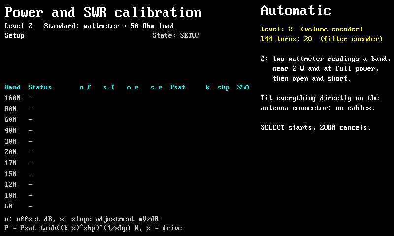

3. The radio asks for the **wattmeter + 50 Ohm load**. Connect the wattmeter to the antenna connector with its load on the meter's output, then press **SELECT**.

   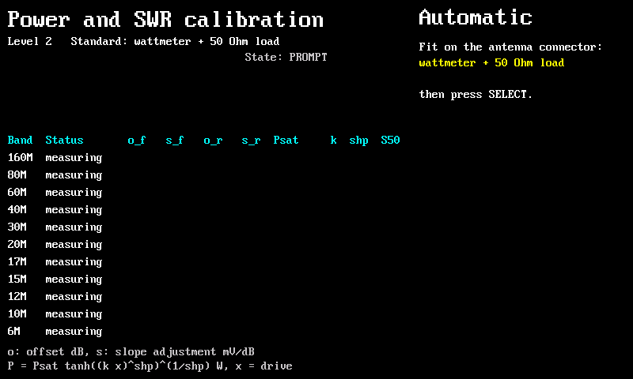

4. Starting with 160 m, the radio sweeps each band exactly as at level 1: the CW carrier from 0 to 31.5 dB attenuation. Leave the connector alone. The example shows the sweep on 20 m.

   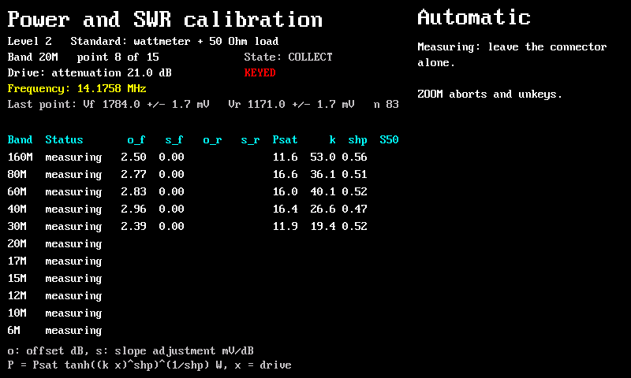

5. After the sweep, the radio keys at the attenuation that gave closest to 2 W and asks for the wattmeter reading. Read the wattmeter. Turn the **filter encoder** until **Measured** shows the same value, then press **SELECT**. The entry starts at the power the radio expects to minimize the needed adjustment. In the example, the radio chose 21 dB attenuation on 20 m and the wattmeter read **1.78 W**:

   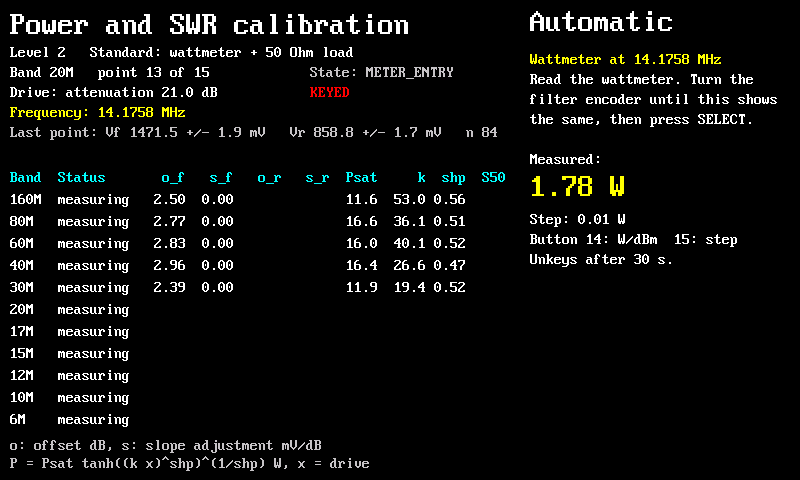

   - **Button 14** switches the entry between W and dBm, if your meter reads in dBm.
   - **Button 15** changes the step.
   - If you do not press SELECT within 30 seconds, the radio stops transmitting to protect the PA. Press **SELECT** to key it again and finish the entry.

6. The radio keys again at full power, with 0 dB attenuation, and asks for the second reading. Dial it in and press **SELECT**. The example shows a power output of **10.96 W** on 20 m:

   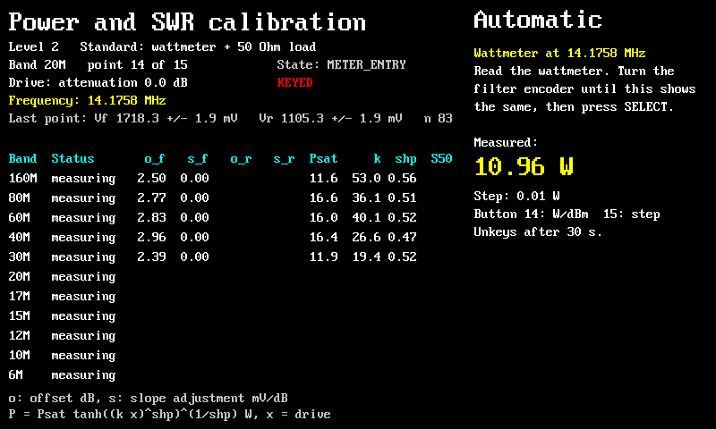

7. The radio sends the short SSB tone into the load and moves to the next band. Repeat steps 5 and 6 on every band. There are 22 readings in all: two each on 160, 80, 60, 40, 30, 20, 17, 15, 12, 10 and 6 m.

8. After 6 m the radio asks for the **open**. Disconnect the wattmeter, leave the antenna connector bare, and press **SELECT**. From here on, the session is the same as level 1 steps 7 to 9: the open, then the **short** fitted directly on the connector. No more wattmeter readings are needed.

9. When the short is done, check the review screen. Radio 2 passed on every band, with 10 m calibrated from the open alone, as at level 1:

   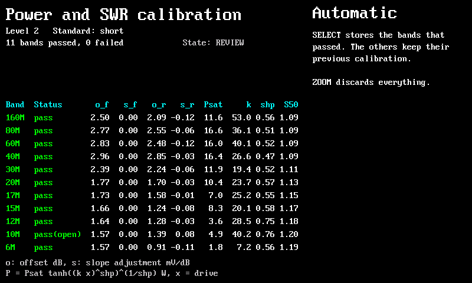

10. Press **SELECT** to store the bands that passed, then **HOME** to leave calibration. If a band failed, see [If a band fails](#if-a-band-fails). Level 2 has one more reason, **level 2 offset**: the 2 W reading was more than 3 dB (4 dB above 20 MHz) from what the L44   turns setting predicts. Check the meter, its range and the L44 turns, then press **button 14** to repeat that band.
