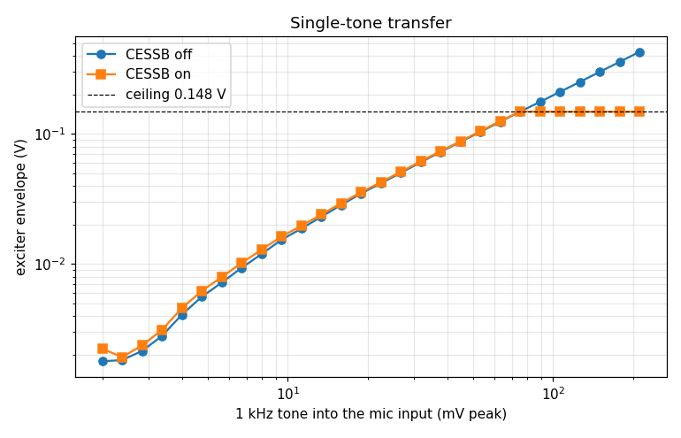
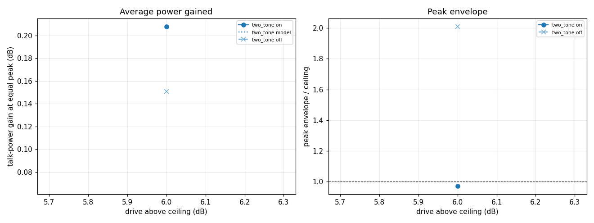

# CESSB bench test — 20261118_172306

**Overall: FAIL** · SSB power 5 W · 176400 sps · key-down 64 s

Ceiling: **0.1484 V** envelope at the exciter; knee at 95.1 mV into the microphone input. Held level spread 0.00 dB over 5 points.

Power tracking: 5 W → 2 W moved the ceiling -3.98 dB (expected -3.98 dB).

## two_tone

Linear reference (CESSB off, below the ceiling): PAPR 3.26 dB, opposite sideband -42.5 dBc, out of channel -48.9 dBc.

| drive dB | CESSB | peak × ceiling | talk-power gain dB | opposite SB dBc | out of channel dBc | 2f1−f2 dBc | 2f2−f1 dBc |
|---:|---:|---:|---:|---:|---:|---:|---:|
| 6 | off | 2.010 | +0.15 | -49.0 | -59.5 | -57.5 | -54.1 |
| 6 | on | 0.970 | +0.21 | -41.1 | -53.8 | -48.4 | -31.3 |
| 6 | model | 0.951 | +0.07 | -58.6 | -92.3 | — | — |

## Checks

| | check | value | limit |
|---|---|---:|---:|
| ✅ | Commanding the other sideband moves the transmitted tone across DC | —  | — |
| ✅ | Both exciter outputs are connected and in quadrature | 36.3 db | 25 |
| ✅ | CESSB holds a 1 kHz tone at a ceiling | —  | — |
| ✅ | Held output is flat above the ceiling (spread) | 0.00243 dB | 1 |
| ❌ | Below the ceiling CESSB on and off agree (worst) | 1.95 dB | 0.3 |
| ✅ | Ceiling moves with the power setting (error) | 0.000515 dB | 0.5 |
| ✅ | two_tone@6dB: peak with CESSB on | -3.02 % over | 5 |
| ✅ | two_tone@6dB: out-of-channel, CESSB on | -53.8 dBc | -45 |
| ✅ | two_tone@6dB: 2f1-f2 in the opposite sideband, CESSB on | -48.4 dBc | -40 |

## Plots

