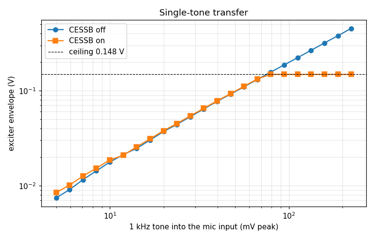
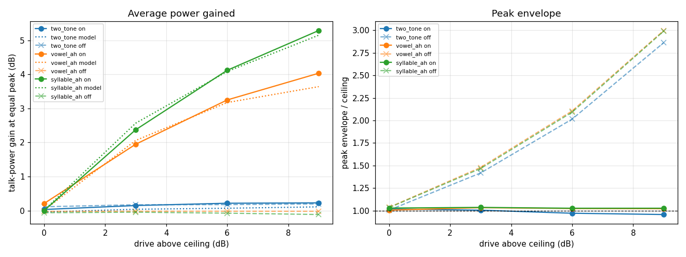

# CESSB bench test — 20261118_172810

**Overall: FAIL** · SSB power 5 W · 176400 sps · key-down 92 s

Ceiling: **0.1484 V** envelope at the exciter; knee at 78.5 mV into the microphone input. Held level spread 0.00 dB over 5 points.

Power tracking: 5 W → 2 W moved the ceiling -3.97 dB (expected -3.98 dB).

## two_tone

Linear reference (CESSB off, below the ceiling): PAPR 3.27 dB, opposite sideband -40.1 dBc, out of channel -46.4 dBc.

| drive dB | CESSB | peak × ceiling | talk-power gain dB | opposite SB dBc | out of channel dBc | 2f1−f2 dBc | 2f2−f1 dBc | +500 Hz mirror dBc |
|---:|---:|---:|---:|---:|---:|---:|---:|---:|
| 0 | off | 1.004 | +0.11 | -48.6 | -53.1 | -51.1 | -49.9 | -41.9 |
| 0 | on | 1.018 | +0.03 | -40.5 | -52.8 | -50.1 | -55.1 | -37.7 |
| 0 | model | 1.006 | -0.04 | -102.0 | -112.2 | — | — | — |
| 3 | off | 1.417 | +0.17 | -50.6 | -57.1 | -55.4 | -54.0 | -45.4 |
| 3 | on | 1.004 | +0.15 | -40.6 | -53.9 | -49.8 | -36.1 | -42.8 |
| 3 | model | 0.979 | +0.04 | -63.0 | -90.4 | — | — | — |
| 6 | off | 2.015 | +0.17 | -49.1 | -59.9 | -58.0 | -53.2 | -45.2 |
| 6 | on | 0.970 | +0.21 | -40.8 | -54.1 | -48.8 | -31.3 | -41.8 |
| 6 | model | 0.951 | +0.07 | -58.6 | -92.3 | — | — | — |
| 9 | off | 2.862 | +0.19 | -48.0 | -62.0 | -61.5 | -52.8 | -43.7 |
| 9 | on | 0.956 | +0.23 | -41.1 | -54.3 | -48.2 | -29.6 | -39.6 |
| 9 | model | 0.934 | +0.11 | -56.8 | -83.8 | — | — | — |

## vowel_ah

Linear reference (CESSB off, below the ceiling): PAPR 5.98 dB, opposite sideband -31.2 dBc, out of channel -46.1 dBc.

| drive dB | CESSB | peak × ceiling | talk-power gain dB | opposite SB dBc | out of channel dBc |
|---:|---:|---:|---:|---:|---:|
| 0 | off | 1.036 | -0.02 | -37.0 | -52.6 |
| 0 | on | 1.005 | +0.21 | -37.1 | -52.4 |
| 0 | model | 0.992 | +0.01 | -86.5 | -105.9 |
| 3 | off | 1.478 | -0.02 | -39.4 | -56.3 |
| 3 | on | 1.032 | +1.95 | -39.0 | -54.9 |
| 3 | model | 0.977 | +2.06 | -75.2 | -99.1 |
| 6 | off | 2.105 | -0.02 | -41.8 | -59.0 |
| 6 | on | 1.023 | +3.25 | -40.1 | -56.0 |
| 6 | model | 1.010 | +3.17 | -73.3 | -93.4 |
| 9 | off | 2.997 | -0.02 | -43.1 | -63.1 |
| 9 | on | 1.021 | +4.03 | -41.2 | -57.5 |
| 9 | model | 1.010 | +3.64 | -66.4 | -93.6 |

## syllable_ah

Linear reference (CESSB off, below the ceiling): PAPR 12.25 dB, opposite sideband -25.9 dBc, out of channel -39.1 dBc.

| drive dB | CESSB | peak × ceiling | talk-power gain dB | opposite SB dBc | out of channel dBc |
|---:|---:|---:|---:|---:|---:|
| 0 | off | 1.032 | -0.06 | -31.9 | -44.9 |
| 0 | on | 1.028 | -0.00 | -32.6 | -45.9 |
| 0 | model | 1.002 | +0.01 | -93.0 | -114.6 |
| 3 | off | 1.466 | -0.05 | -35.5 | -48.0 |
| 3 | on | 1.035 | +2.37 | -35.6 | -48.2 |
| 3 | model | 0.978 | +2.57 | -78.4 | -100.0 |
| 6 | off | 2.092 | -0.08 | -38.7 | -51.2 |
| 6 | on | 1.026 | +4.12 | -37.5 | -50.3 |
| 6 | model | 1.014 | +4.08 | -76.5 | -97.5 |
| 9 | off | 2.990 | -0.12 | -41.6 | -54.3 |
| 9 | on | 1.026 | +5.29 | -38.9 | -51.4 |
| 9 | model | 1.014 | +5.15 | -70.2 | -97.6 |

## Checks

| | check | value | limit |
|---|---|---:|---:|
| ✅ | Commanding the other sideband moves the transmitted tone across DC | —  | — |
| ✅ | Both exciter outputs are connected and in quadrature | 36.4 db | 25 |
| ✅ | CESSB holds a 1 kHz tone at a ceiling | —  | — |
| ✅ | Held output is flat above the ceiling (spread) | 0.00169 dB | 1 |
| ✅ | Below the ceiling CESSB on and off agree (worst) | 0.176 dB | 0.3 |
| ✅ | Ceiling moves with the power setting (error) | 0.00633 dB | 0.5 |
| ✅ | two_tone@0dB: peak with CESSB on | 1.82 % over | 5 |
| ✅ | two_tone@0dB: out-of-channel, CESSB on | -52.8 dBc | -45 |
| ✅ | two_tone@0dB: 2f1-f2 in the opposite sideband, CESSB on | -50.1 dBc | -40 |
| ✅ | two_tone@3dB: peak with CESSB on | 0.384 % over | 5 |
| ✅ | two_tone@3dB: out-of-channel, CESSB on | -53.9 dBc | -45 |
| ✅ | two_tone@3dB: 2f1-f2 in the opposite sideband, CESSB on | -49.8 dBc | -40 |
| ✅ | two_tone@6dB: peak with CESSB on | -2.98 % over | 5 |
| ✅ | two_tone@6dB: out-of-channel, CESSB on | -54.1 dBc | -45 |
| ✅ | two_tone@6dB: 2f1-f2 in the opposite sideband, CESSB on | -48.8 dBc | -40 |
| ✅ | two_tone@9dB: peak with CESSB on | -4.41 % over | 5 |
| ✅ | two_tone@9dB: out-of-channel, CESSB on | -54.3 dBc | -45 |
| ✅ | two_tone@9dB: 2f1-f2 in the opposite sideband, CESSB on | -48.2 dBc | -40 |
| ✅ | vowel_ah@0dB: peak with CESSB on | 0.501 % over | 5 |
| ✅ | vowel_ah@0dB: out-of-channel, CESSB on | -52.4 dBc | -45 |
| ✅ | vowel_ah@0dB: opposite sideband, CESSB on | -37.1 dBc | -35 |
| ✅ | vowel_ah@3dB: peak with CESSB on | 3.2 % over | 5 |
| ✅ | vowel_ah@3dB: out-of-channel, CESSB on | -54.9 dBc | -45 |
| ✅ | vowel_ah@3dB: opposite sideband, CESSB on | -39 dBc | -35 |
| ✅ | vowel_ah@6dB: peak with CESSB on | 2.26 % over | 5 |
| ✅ | vowel_ah@6dB: out-of-channel, CESSB on | -56 dBc | -45 |
| ✅ | vowel_ah@6dB: opposite sideband, CESSB on | -40.1 dBc | -35 |
| ✅ | vowel_ah@9dB: peak with CESSB on | 2.07 % over | 5 |
| ✅ | vowel_ah@9dB: out-of-channel, CESSB on | -57.5 dBc | -45 |
| ✅ | vowel_ah@9dB: opposite sideband, CESSB on | -41.2 dBc | -35 |
| ✅ | syllable_ah@0dB: peak with CESSB on | 2.78 % over | 5 |
| ✅ | syllable_ah@0dB: out-of-channel, CESSB on | -45.9 dBc | -45 |
| ❌ | syllable_ah@0dB: opposite sideband, CESSB on | -32.6 dBc | -35 |
| ✅ | syllable_ah@3dB: peak with CESSB on | 3.49 % over | 5 |
| ✅ | syllable_ah@3dB: out-of-channel, CESSB on | -48.2 dBc | -45 |
| ✅ | syllable_ah@3dB: opposite sideband, CESSB on | -35.6 dBc | -35 |
| ✅ | syllable_ah@6dB: peak with CESSB on | 2.56 % over | 5 |
| ✅ | syllable_ah@6dB: out-of-channel, CESSB on | -50.3 dBc | -45 |
| ✅ | syllable_ah@6dB: opposite sideband, CESSB on | -37.5 dBc | -35 |
| ✅ | syllable_ah@6dB: talk-power gain at equal peak | 4.12 dB | 3 |
| ✅ | syllable_ah@9dB: peak with CESSB on | 2.57 % over | 5 |
| ✅ | syllable_ah@9dB: out-of-channel, CESSB on | -51.4 dBc | -45 |
| ✅ | syllable_ah@9dB: opposite sideband, CESSB on | -38.9 dBc | -35 |

## Plots

