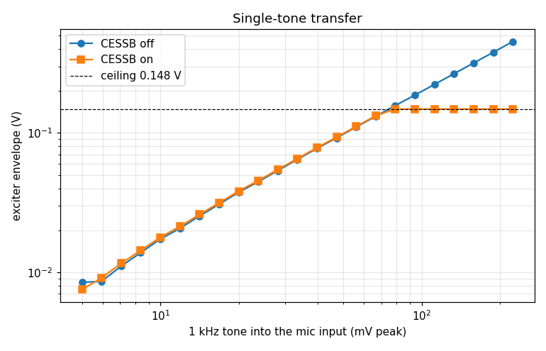
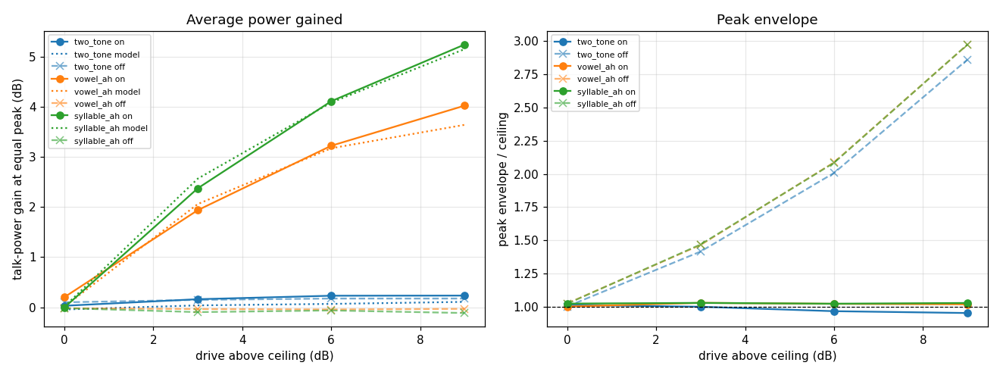

# CESSB bench test — 20261118_173504

**Overall: PASS** · SSB power 5 W · 176400 sps · key-down 94 s

Ceiling: **0.1483 V** envelope at the exciter; knee at 77.8 mV into the microphone input. Held level spread 0.00 dB over 5 points.

Power tracking: 5 W → 2 W moved the ceiling -3.97 dB (expected -3.98 dB).

## two_tone

Linear reference (CESSB off, below the ceiling): PAPR 3.26 dB, opposite sideband -41.5 dBc, out of channel -47.1 dBc.

| drive dB | CESSB | peak × ceiling | talk-power gain dB | opposite SB dBc | out of channel dBc | 2f1−f2 dBc | 2f2−f1 dBc | +500 Hz mirror dBc |
|---:|---:|---:|---:|---:|---:|---:|---:|---:|
| 0 | off | 1.003 | +0.10 | -48.9 | -54.3 | -51.3 | -51.0 | -42.5 |
| 0 | on | 1.016 | +0.03 | -41.1 | -54.2 | -51.0 | -56.5 | -38.9 |
| 0 | model | 1.006 | -0.04 | -102.0 | -112.2 | — | — | — |
| 3 | off | 1.417 | +0.15 | -49.1 | -57.4 | -55.8 | -54.5 | -45.5 |
| 3 | on | 1.001 | +0.16 | -41.3 | -54.9 | -50.9 | -36.1 | -43.6 |
| 3 | model | 0.979 | +0.04 | -63.0 | -90.4 | — | — | — |
| 6 | off | 2.007 | +0.17 | -47.8 | -60.6 | -59.0 | -54.3 | -45.8 |
| 6 | on | 0.968 | +0.23 | -41.6 | -55.0 | -49.6 | -31.3 | -42.6 |
| 6 | model | 0.951 | +0.07 | -58.6 | -92.3 | — | — | — |
| 9 | off | 2.860 | +0.17 | -47.0 | -62.6 | -63.2 | -53.3 | -44.1 |
| 9 | on | 0.954 | +0.23 | -41.7 | -55.3 | -49.6 | -29.5 | -40.9 |
| 9 | model | 0.934 | +0.11 | -56.8 | -83.8 | — | — | — |

## vowel_ah

Linear reference (CESSB off, below the ceiling): PAPR 5.98 dB, opposite sideband -32.7 dBc, out of channel -47.4 dBc.

| drive dB | CESSB | peak × ceiling | talk-power gain dB | opposite SB dBc | out of channel dBc |
|---:|---:|---:|---:|---:|---:|
| 0 | off | 1.026 | -0.02 | -38.0 | -53.1 |
| 0 | on | 1.003 | +0.20 | -38.1 | -53.7 |
| 0 | model | 0.992 | +0.01 | -86.5 | -105.9 |
| 3 | off | 1.466 | -0.03 | -40.2 | -57.0 |
| 3 | on | 1.031 | +1.94 | -39.6 | -55.8 |
| 3 | model | 0.977 | +2.06 | -75.2 | -99.1 |
| 6 | off | 2.087 | -0.04 | -42.1 | -59.3 |
| 6 | on | 1.023 | +3.22 | -41.1 | -57.0 |
| 6 | model | 1.010 | +3.17 | -73.3 | -93.4 |
| 9 | off | 2.972 | -0.03 | -43.3 | -63.6 |
| 9 | on | 1.020 | +4.02 | -41.7 | -58.4 |
| 9 | model | 1.010 | +3.64 | -66.4 | -93.6 |

## syllable_ah

Linear reference (CESSB off, below the ceiling): PAPR 12.26 dB, opposite sideband -27.1 dBc, out of channel -40.0 dBc.

| drive dB | CESSB | peak × ceiling | talk-power gain dB | opposite SB dBc | out of channel dBc |
|---:|---:|---:|---:|---:|---:|
| 0 | off | 1.024 | -0.02 | -33.5 | -45.9 |
| 0 | on | 1.025 | -0.01 | -34.0 | -46.9 |
| 0 | model | 1.002 | +0.01 | -93.0 | -114.6 |
| 3 | off | 1.470 | -0.10 | -36.9 | -49.1 |
| 3 | on | 1.030 | +2.37 | -36.7 | -49.4 |
| 3 | model | 0.978 | +2.57 | -78.4 | -100.0 |
| 6 | off | 2.084 | -0.06 | -40.0 | -52.2 |
| 6 | on | 1.024 | +4.11 | -38.6 | -51.3 |
| 6 | model | 1.014 | +4.08 | -76.5 | -97.5 |
| 9 | off | 2.973 | -0.11 | -42.4 | -54.9 |
| 9 | on | 1.030 | +5.24 | -39.8 | -52.5 |
| 9 | model | 1.014 | +5.15 | -70.2 | -97.6 |

## Checks

| | check | value | limit |
|---|---|---:|---:|
| ✅ | Commanding the other sideband moves the transmitted tone across DC | —  | — |
| ✅ | Both exciter outputs are connected and in quadrature | 35.2 db | 25 |
| ✅ | CESSB holds a 1 kHz tone at a ceiling | —  | — |
| ✅ | Held output is flat above the ceiling (spread) | 0.00251 dB | 1 |
| ✅ | Below the ceiling CESSB on and off agree (worst) | 0.168 dB | 0.3 |
| ✅ | Ceiling moves with the power setting (error) | 0.00537 dB | 0.5 |
| ✅ | two_tone@0dB: peak with CESSB on | 1.56 % over | 5 |
| ✅ | two_tone@0dB: out-of-channel, CESSB on | -54.2 dBc | -45 |
| ✅ | two_tone@0dB: 2f1-f2 in the opposite sideband, CESSB on | -51 dBc | -40 |
| ✅ | two_tone@3dB: peak with CESSB on | 0.128 % over | 5 |
| ✅ | two_tone@3dB: out-of-channel, CESSB on | -54.9 dBc | -45 |
| ✅ | two_tone@3dB: 2f1-f2 in the opposite sideband, CESSB on | -50.9 dBc | -40 |
| ✅ | two_tone@6dB: peak with CESSB on | -3.19 % over | 5 |
| ✅ | two_tone@6dB: out-of-channel, CESSB on | -55 dBc | -45 |
| ✅ | two_tone@6dB: 2f1-f2 in the opposite sideband, CESSB on | -49.6 dBc | -40 |
| ✅ | two_tone@9dB: peak with CESSB on | -4.57 % over | 5 |
| ✅ | two_tone@9dB: out-of-channel, CESSB on | -55.3 dBc | -45 |
| ✅ | two_tone@9dB: 2f1-f2 in the opposite sideband, CESSB on | -49.6 dBc | -40 |
| ✅ | vowel_ah@0dB: peak with CESSB on | 0.302 % over | 5 |
| ✅ | vowel_ah@0dB: out-of-channel, CESSB on | -53.7 dBc | -45 |
| ✅ | vowel_ah@0dB: opposite sideband, CESSB on (gross-failure guard) | -38.1 dBc | -25 |
| ✅ | vowel_ah@3dB: peak with CESSB on | 3.07 % over | 5 |
| ✅ | vowel_ah@3dB: out-of-channel, CESSB on | -55.8 dBc | -45 |
| ✅ | vowel_ah@3dB: opposite sideband, CESSB on (gross-failure guard) | -39.6 dBc | -25 |
| ✅ | vowel_ah@6dB: peak with CESSB on | 2.33 % over | 5 |
| ✅ | vowel_ah@6dB: out-of-channel, CESSB on | -57 dBc | -45 |
| ✅ | vowel_ah@6dB: opposite sideband, CESSB on (gross-failure guard) | -41.1 dBc | -25 |
| ✅ | vowel_ah@9dB: peak with CESSB on | 1.98 % over | 5 |
| ✅ | vowel_ah@9dB: out-of-channel, CESSB on | -58.4 dBc | -45 |
| ✅ | vowel_ah@9dB: opposite sideband, CESSB on (gross-failure guard) | -41.7 dBc | -25 |
| ✅ | syllable_ah@0dB: peak with CESSB on | 2.5 % over | 5 |
| ✅ | syllable_ah@0dB: out-of-channel, CESSB on | -46.9 dBc | -45 |
| ✅ | syllable_ah@0dB: opposite sideband, CESSB on (gross-failure guard) | -34 dBc | -25 |
| ✅ | syllable_ah@3dB: peak with CESSB on | 3.04 % over | 5 |
| ✅ | syllable_ah@3dB: out-of-channel, CESSB on | -49.4 dBc | -45 |
| ✅ | syllable_ah@3dB: opposite sideband, CESSB on (gross-failure guard) | -36.7 dBc | -25 |
| ✅ | syllable_ah@6dB: peak with CESSB on | 2.43 % over | 5 |
| ✅ | syllable_ah@6dB: out-of-channel, CESSB on | -51.3 dBc | -45 |
| ✅ | syllable_ah@6dB: opposite sideband, CESSB on (gross-failure guard) | -38.6 dBc | -25 |
| ✅ | syllable_ah@6dB: talk-power gain at equal peak | 4.11 dB | 3 |
| ✅ | syllable_ah@9dB: peak with CESSB on | 2.98 % over | 5 |
| ✅ | syllable_ah@9dB: out-of-channel, CESSB on | -52.5 dBc | -45 |
| ✅ | syllable_ah@9dB: opposite sideband, CESSB on (gross-failure guard) | -39.8 dBc | -25 |

## Plots

