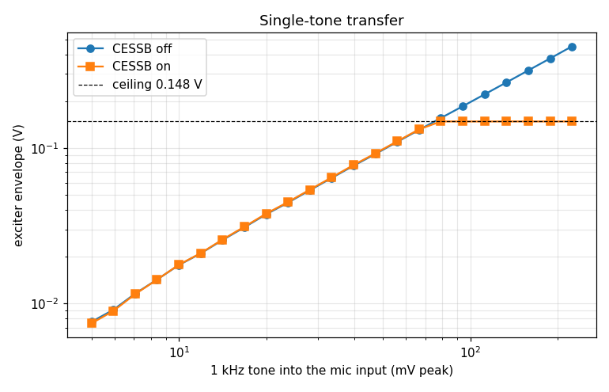
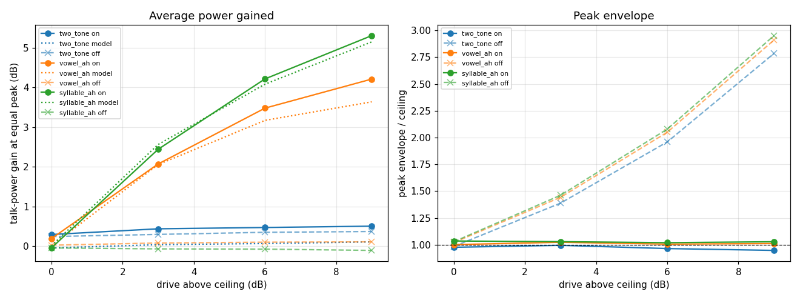

# CESSB bench test — 20261118_175345

**Overall: PASS** · SSB power 5 W · 176400 sps · key-down 103 s

Ceiling: **0.1483 V** envelope at the exciter; knee at 77.9 mV into the microphone input. Held level spread 0.01 dB over 5 points.

Power tracking: 5 W → 2 W moved the ceiling -3.98 dB (expected -3.98 dB).

## two_tone

Linear reference (CESSB off, below the ceiling): PAPR 3.48 dB, opposite sideband -38.7 dBc, out of channel -47.0 dBc.

| drive dB | CESSB | peak × ceiling | talk-power gain dB | opposite SB dBc | out of channel dBc | 2f1−f2 dBc | 2f2−f1 dBc | +500 Hz mirror dBc |
|---:|---:|---:|---:|---:|---:|---:|---:|---:|
| 0 | off | 0.984 | +0.24 | -43.0 | -53.8 | -51.8 | -51.8 | -39.7 |
| 0 | on | 0.976 | +0.29 | -40.2 | -54.0 | -52.2 | -56.6 | -45.4 |
| 0 | model | 1.006 | -0.04 | -102.0 | -112.2 | — | — | — |
| 3 | off | 1.388 | +0.30 | -44.3 | -57.2 | -56.2 | -55.2 | -43.8 |
| 3 | on | 0.994 | +0.44 | -40.9 | -54.8 | -52.7 | -36.7 | -56.2 |
| 3 | model | 0.979 | +0.04 | -63.0 | -90.4 | — | — | — |
| 6 | off | 1.959 | +0.35 | -45.0 | -60.8 | -57.9 | -54.2 | -43.1 |
| 6 | on | 0.964 | +0.47 | -40.9 | -55.0 | -50.4 | -31.5 | -50.7 |
| 6 | model | 0.951 | +0.07 | -58.6 | -92.3 | — | — | — |
| 9 | off | 2.785 | +0.37 | -45.4 | -63.1 | -64.7 | -52.9 | -43.1 |
| 9 | on | 0.947 | +0.50 | -41.2 | -55.2 | -51.0 | -29.6 | -45.5 |
| 9 | model | 0.934 | +0.11 | -56.8 | -83.8 | — | — | — |

## vowel_ah

Linear reference (CESSB off, below the ceiling): PAPR 6.17 dB, opposite sideband -34.1 dBc, out of channel -48.4 dBc.

| drive dB | CESSB | peak × ceiling | talk-power gain dB | opposite SB dBc | out of channel dBc |
|---:|---:|---:|---:|---:|---:|
| 0 | off | 1.021 | +0.03 | -40.0 | -54.1 |
| 0 | on | 1.001 | +0.19 | -38.3 | -53.5 |
| 0 | model | 0.992 | +0.01 | -86.5 | -105.9 |
| 3 | off | 1.442 | +0.08 | -42.4 | -57.1 |
| 3 | on | 1.023 | +2.07 | -40.0 | -56.6 |
| 3 | model | 0.977 | +2.06 | -75.2 | -99.1 |
| 6 | off | 2.050 | +0.10 | -44.2 | -60.7 |
| 6 | on | 1.006 | +3.48 | -41.3 | -57.5 |
| 6 | model | 1.010 | +3.17 | -73.3 | -93.4 |
| 9 | off | 2.910 | +0.11 | -45.0 | -63.0 |
| 9 | on | 1.011 | +4.21 | -42.2 | -58.9 |
| 9 | model | 1.010 | +3.64 | -66.4 | -93.6 |

## syllable_ah

Linear reference (CESSB off, below the ceiling): PAPR 12.34 dB, opposite sideband -27.2 dBc, out of channel -40.9 dBc.

| drive dB | CESSB | peak × ceiling | talk-power gain dB | opposite SB dBc | out of channel dBc |
|---:|---:|---:|---:|---:|---:|
| 0 | off | 1.028 | -0.04 | -33.1 | -46.5 |
| 0 | on | 1.035 | -0.04 | -34.3 | -47.2 |
| 0 | model | 1.002 | +0.01 | -93.0 | -114.6 |
| 3 | off | 1.461 | -0.07 | -36.3 | -49.7 |
| 3 | on | 1.029 | +2.44 | -37.3 | -49.7 |
| 3 | model | 0.978 | +2.57 | -78.4 | -100.0 |
| 6 | off | 2.079 | -0.07 | -39.1 | -52.5 |
| 6 | on | 1.019 | +4.22 | -39.1 | -51.5 |
| 6 | model | 1.014 | +4.08 | -76.5 | -97.5 |
| 9 | off | 2.951 | -0.11 | -41.4 | -55.5 |
| 9 | on | 1.028 | +5.31 | -40.4 | -52.8 |
| 9 | model | 1.014 | +5.15 | -70.2 | -97.6 |

## Checks

| | check | value | limit |
|---|---|---:|---:|
| ✅ | Commanding the other sideband moves the transmitted tone across DC | —  | — |
| ✅ | Both exciter outputs are connected and in quadrature | 34.1 db | 25 |
| ✅ | CESSB holds a 1 kHz tone at a ceiling | —  | — |
| ✅ | Held output is flat above the ceiling (spread) | 0.00533 dB | 1 |
| ✅ | Below the ceiling CESSB on and off agree (worst) | 0.0758 dB | 0.3 |
| ✅ | Ceiling moves with the power setting (error) | -0.000251 dB | 0.5 |
| ✅ | Processor level is gain into the clipper (worst error) | 0.244 dB | 0.5 |
| ✅ | Compression meter over CAT RM (worst error) | 0 dots | 1 |
| ✅ | two_tone@0dB: peak with CESSB on | -2.37 % over | 5 |
| ✅ | two_tone@0dB: out-of-channel, CESSB on | -54 dBc | -45 |
| ✅ | two_tone@0dB: 2f1-f2 in the opposite sideband, CESSB on | -52.2 dBc | -40 |
| ✅ | two_tone@3dB: peak with CESSB on | -0.553 % over | 5 |
| ✅ | two_tone@3dB: out-of-channel, CESSB on | -54.8 dBc | -45 |
| ✅ | two_tone@3dB: 2f1-f2 in the opposite sideband, CESSB on | -52.7 dBc | -40 |
| ✅ | two_tone@6dB: peak with CESSB on | -3.56 % over | 5 |
| ✅ | two_tone@6dB: out-of-channel, CESSB on | -55 dBc | -45 |
| ✅ | two_tone@6dB: 2f1-f2 in the opposite sideband, CESSB on | -50.4 dBc | -40 |
| ✅ | two_tone@9dB: peak with CESSB on | -5.29 % over | 5 |
| ✅ | two_tone@9dB: out-of-channel, CESSB on | -55.2 dBc | -45 |
| ✅ | two_tone@9dB: 2f1-f2 in the opposite sideband, CESSB on | -51 dBc | -40 |
| ✅ | vowel_ah@0dB: peak with CESSB on | 0.104 % over | 5 |
| ✅ | vowel_ah@0dB: out-of-channel, CESSB on | -53.5 dBc | -45 |
| ✅ | vowel_ah@0dB: opposite sideband, CESSB on (gross-failure guard) | -38.3 dBc | -25 |
| ✅ | vowel_ah@3dB: peak with CESSB on | 2.31 % over | 5 |
| ✅ | vowel_ah@3dB: out-of-channel, CESSB on | -56.6 dBc | -45 |
| ✅ | vowel_ah@3dB: opposite sideband, CESSB on (gross-failure guard) | -40 dBc | -25 |
| ✅ | vowel_ah@6dB: peak with CESSB on | 0.55 % over | 5 |
| ✅ | vowel_ah@6dB: out-of-channel, CESSB on | -57.5 dBc | -45 |
| ✅ | vowel_ah@6dB: opposite sideband, CESSB on (gross-failure guard) | -41.3 dBc | -25 |
| ✅ | vowel_ah@9dB: peak with CESSB on | 1.13 % over | 5 |
| ✅ | vowel_ah@9dB: out-of-channel, CESSB on | -58.9 dBc | -45 |
| ✅ | vowel_ah@9dB: opposite sideband, CESSB on (gross-failure guard) | -42.2 dBc | -25 |
| ✅ | syllable_ah@0dB: peak with CESSB on | 3.5 % over | 5 |
| ✅ | syllable_ah@0dB: out-of-channel, CESSB on | -47.2 dBc | -45 |
| ✅ | syllable_ah@0dB: opposite sideband, CESSB on (gross-failure guard) | -34.3 dBc | -25 |
| ✅ | syllable_ah@3dB: peak with CESSB on | 2.87 % over | 5 |
| ✅ | syllable_ah@3dB: out-of-channel, CESSB on | -49.7 dBc | -45 |
| ✅ | syllable_ah@3dB: opposite sideband, CESSB on (gross-failure guard) | -37.3 dBc | -25 |
| ✅ | syllable_ah@6dB: peak with CESSB on | 1.91 % over | 5 |
| ✅ | syllable_ah@6dB: out-of-channel, CESSB on | -51.5 dBc | -45 |
| ✅ | syllable_ah@6dB: opposite sideband, CESSB on (gross-failure guard) | -39.1 dBc | -25 |
| ✅ | syllable_ah@6dB: talk-power gain at equal peak | 4.22 dB | 3 |
| ✅ | syllable_ah@9dB: peak with CESSB on | 2.8 % over | 5 |
| ✅ | syllable_ah@9dB: out-of-channel, CESSB on | -52.8 dBc | -45 |
| ✅ | syllable_ah@9dB: opposite sideband, CESSB on (gross-failure guard) | -40.4 dBc | -25 |

## Plots

