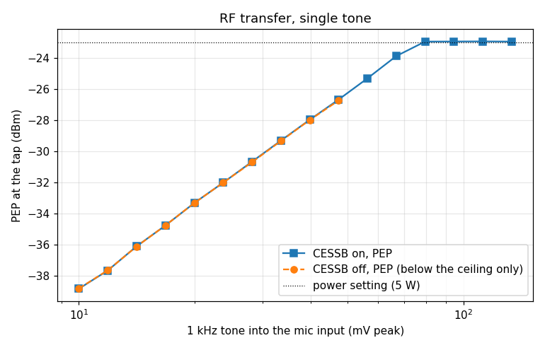
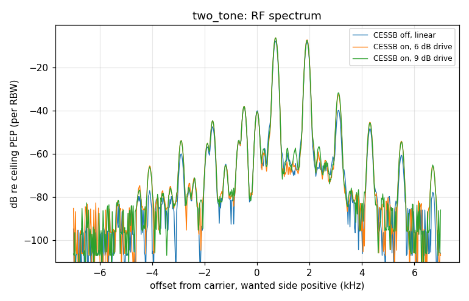
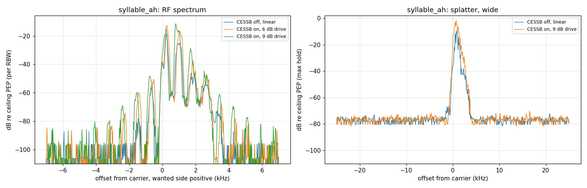
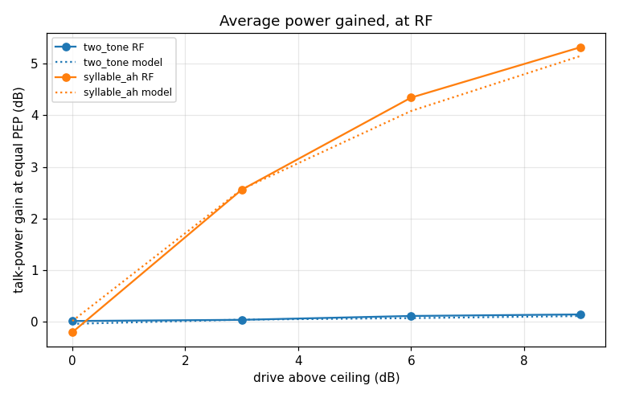

# CESSB RF test — 20261119_065728

**Overall: FAIL** · 14.175000 MHz MD2 · SSB power 5 W · 176400 sps · tap 60.0 dB into CMU200 RF1 · key-down 212 s

Ceiling: PEP **-22.96 dBm** at the tap = **5.05 W** (setting 5 W = -23.01 dBm at the tap; +0.05 dB). Held spread 0.01 dB. Knee 66.6 mV into the microphone input.

Power tracking: 5 W → 2 W moved the held PEP -3.59 dB (expected -3.98 dB).

## two_tone

| | PEP re ceiling dB | PAPR dB | talk-power gain dB | model dB | avg W | opposite dBc | out of channel dBc | carrier dBc | 2f1−f2 dBc | 2f2−f1 dBc | 3f1−2f2 dBc | 3f2−2f1 dBc |
|---:|---:|---:|---:|---:|---:|---:|---:|---:|---:|---:|---:|---:|
| ref (off) | -1.66 | 3.07 | — | — | 1.70 | -32.5 | -43.0 | -41.5 | -30.1 | -31.8 | -39.4 | -40.4 |
| 0 dB on | -0.69 | 3.06 | +0.01 | -0.04 | 2.13 | — | — | — | — | — | — | — |
| 3 dB on | -0.20 | 3.03 | +0.03 | +0.04 | 2.40 | — | — | — | — | — | — | — |
| 6 dB on | -0.50 | 2.96 | +0.11 | +0.07 | 2.28 | -33.2 | -41.0 | -43.3 | -31.2 | -25.8 | -37.8 | -38.6 |
| 9 dB on | -0.65 | 2.93 | +0.14 | +0.11 | 2.21 | -33.1 | -41.1 | -43.1 | -31.1 | -24.9 | -37.7 | -38.8 |

## syllable_ah

| | PEP re ceiling dB | PAPR dB | talk-power gain dB | model dB | avg W | opposite dBc | out of channel dBc | carrier dBc |
|---:|---:|---:|---:|---:|---:|---:|---:|---:|
| ref (off) | -0.95 | 12.04 | — | — | 0.25 | -38.6 | -54.3 | -28.3 |
| 0 dB on | -0.17 | 12.25 | -0.21 | +0.01 | 0.29 | — | — | — |
| 3 dB on | -0.19 | 9.49 | +2.56 | +2.57 | 0.54 | — | — | — |
| 6 dB on | -0.16 | 7.70 | +4.34 | +4.08 | 0.83 | -38.8 | -57.7 | -34.4 |
| 9 dB on | -0.07 | 6.72 | +5.32 | +5.15 | 1.06 | -37.5 | -50.6 | -26.2 |

## Checks

| | check | value | limit |
|---|---|---:|---:|
| ✅ | Held PEP is flat (spread over the last 4 steps) | 0.0113 dB | 0.5 |
| ✅ | Held PEP equals the power setting (through a 60 dB tap) | 0.0456 dB | 1 |
| ✅ | Below the ceiling CESSB on and off agree at RF (worst) | 0.0662 dB | 0.3 |
| ✅ | Held PEP follows the power setting (error) | 0.388 dB | 0.5 |
| ✅ | two_tone@0dB: PEP over the ceiling, CESSB on | -0.69 dB | 0.45 |
| ✅ | two_tone@3dB: PEP over the ceiling, CESSB on | -0.196 dB | 0.45 |
| ✅ | two_tone@6dB: PEP over the ceiling, CESSB on | -0.496 dB | 0.45 |
| ✅ | two_tone@6dB: out of channel, CESSB on | -41 dBc | -35 |
| ✅ | two_tone@6dB: out of channel, CESSB on minus linear reference | 2.05 dB | 3 |
| ✅ | two_tone@6dB: 2f1-f2 (opposite sideband), CESSB on minus linear reference | -1.05 dB | 3 |
| ✅ | two_tone@9dB: PEP over the ceiling, CESSB on | -0.654 dB | 0.45 |
| ✅ | two_tone@9dB: out of channel, CESSB on | -41.1 dBc | -35 |
| ✅ | two_tone@9dB: out of channel, CESSB on minus linear reference | 1.9 dB | 3 |
| ✅ | two_tone@9dB: 2f1-f2 (opposite sideband), CESSB on minus linear reference | -1 dB | 3 |
| ✅ | syllable_ah@0dB: PEP over the ceiling, CESSB on | -0.174 dB | 0.45 |
| ✅ | syllable_ah@3dB: PEP over the ceiling, CESSB on | -0.192 dB | 0.45 |
| ✅ | syllable_ah@6dB: PEP over the ceiling, CESSB on | -0.159 dB | 0.45 |
| ✅ | syllable_ah@6dB: out of channel, CESSB on | -57.7 dBc | -35 |
| ✅ | syllable_ah@6dB: out of channel, CESSB on minus linear reference | -3.34 dB | 3 |
| ✅ | syllable_ah@6dB: opposite sideband, CESSB on minus linear reference | -0.19 dB | 3 |
| ✅ | syllable_ah@6dB: talk-power gain at equal PEP, at RF | 4.34 dB | 3 |
| ✅ | syllable_ah@9dB: PEP over the ceiling, CESSB on | -0.0661 dB | 0.45 |
| ✅ | syllable_ah@9dB: out of channel, CESSB on | -50.6 dBc | -35 |
| ❌ | syllable_ah@9dB: out of channel, CESSB on minus linear reference | 3.73 dB | 3 |
| ✅ | syllable_ah@9dB: opposite sideband, CESSB on minus linear reference | 1.1 dB | 3 |

## Plots

