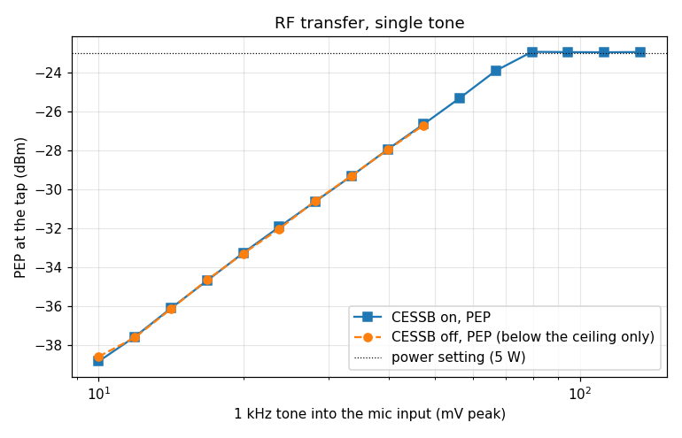
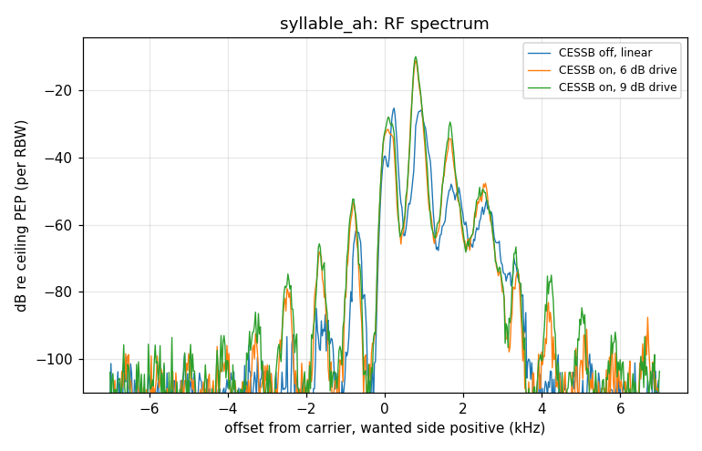
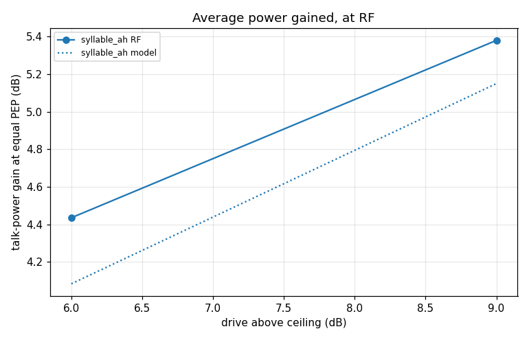

# CESSB RF test — 20261119_070320

**Overall: PASS** · 14.175000 MHz MD2 · SSB power 5 W · 176400 sps · tap 60.0 dB into CMU200 RF1 · key-down 274 s

Ceiling: PEP **-22.96 dBm** at the tap = **5.06 W** (setting 5 W = -23.01 dBm at the tap; +0.05 dB). Held spread 0.02 dB. Knee 66.5 mV into the microphone input.

## syllable_ah

| | PEP re ceiling dB | PAPR dB | talk-power gain dB | model dB | avg W | opposite dBc | out of channel dBc | carrier dBc |
|---:|---:|---:|---:|---:|---:|---:|---:|---:|
| ref (off) | -1.26 | 12.34 | — | — | 0.22 | -38.4 | -50.2 | -24.0 |
| 6 dB on | -0.13 | 7.90 | +4.43 | +4.08 | 0.80 | -42.6 | -62.5 | -27.5 |
| 9 dB on | -0.05 | 6.96 | +5.38 | +5.15 | 1.01 | -42.1 | -58.1 | -27.0 |

## Checks

| | check | value | limit |
|---|---|---:|---:|
| ✅ | Held PEP is flat (spread over the last 4 steps) | 0.0239 dB | 0.5 |
| ✅ | Held PEP equals the power setting (through a 60 dB tap) | 0.0486 dB | 1 |
| ✅ | Below the ceiling CESSB on and off agree at RF (worst) | 0.0574 dB | 0.3 |
| ✅ | syllable_ah@6dB: PEP over the ceiling, CESSB on | -0.125 dB | 0.45 |
| ✅ | syllable_ah@6dB: out of channel, CESSB on | -62.5 dBc | -35 |
| ✅ | syllable_ah@6dB: out of channel, CESSB on minus linear reference | -12.3 dB | 3 |
| ✅ | syllable_ah@6dB: opposite sideband, CESSB on minus linear reference | -4.16 dB | 3 |
| ✅ | syllable_ah@6dB: talk-power gain at equal PEP, at RF | 4.43 dB | 3 |
| ✅ | syllable_ah@9dB: PEP over the ceiling, CESSB on | -0.0481 dB | 0.45 |
| ✅ | syllable_ah@9dB: out of channel, CESSB on | -58.1 dBc | -35 |
| ✅ | syllable_ah@9dB: out of channel, CESSB on minus linear reference | -7.88 dB | 3 |
| ✅ | syllable_ah@9dB: opposite sideband, CESSB on minus linear reference | -3.69 dB | 3 |

## Plots

