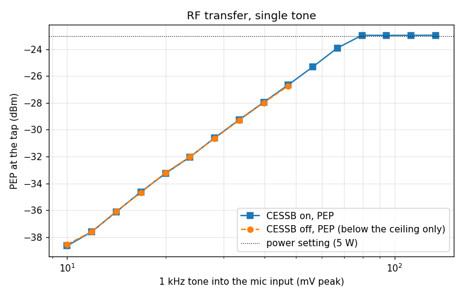
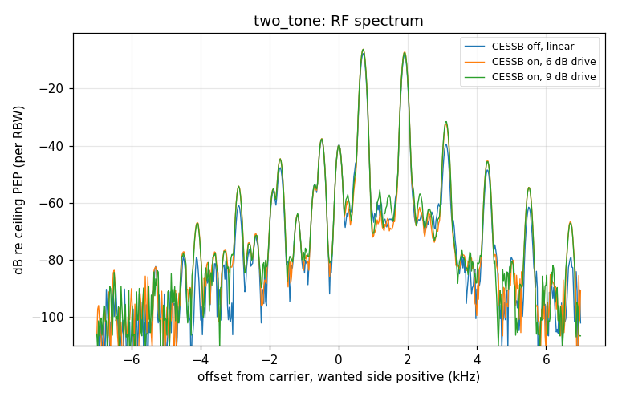
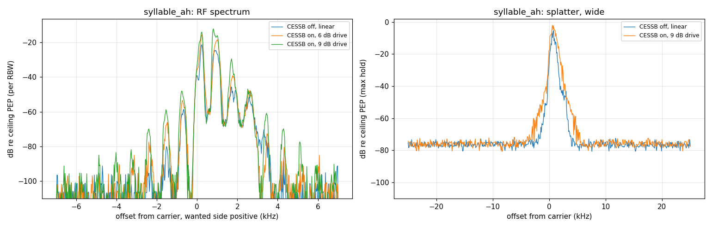
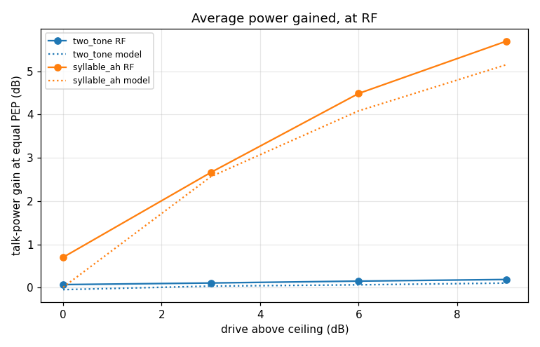

# CESSB RF test — 20261119_071034

**Overall: PASS** · 14.175000 MHz MD2 · SSB power 5 W · 176400 sps · tap 60.0 dB into CMU200 RF1 · key-down 329 s

Ceiling: PEP **-22.96 dBm** at the tap = **5.06 W** (setting 5 W = -23.01 dBm at the tap; +0.05 dB). Held spread 0.01 dB. Knee 66.1 mV into the microphone input.

Power tracking: 5 W → 2 W moved the held PEP -3.58 dB (expected -3.98 dB).

## two_tone

| | PEP re ceiling dB | PAPR dB | talk-power gain dB | model dB | avg W | opposite dBc | out of channel dBc | out of channel dB re PEP | carrier dBc | 2f1−f2 dBc | 2f2−f1 dBc | 3f1−2f2 dBc | 3f2−2f1 dBc |
|---:|---:|---:|---:|---:|---:|---:|---:|---:|---:|---:|---:|---:|---:|
| ref (off) | -1.67 | 3.10 | — | — | 1.69 | -32.3 | -43.3 | -48.1 | -41.2 | -29.9 | -31.7 | -39.7 | -40.5 |
| 0 dB on | -0.77 | 3.03 | +0.07 | -0.04 | 2.11 | — | — | — | — | — | — | — | — |
| 3 dB on | -0.24 | 2.99 | +0.11 | +0.04 | 2.40 | — | — | — | — | — | — | — | — |
| 6 dB on | -0.51 | 2.95 | +0.15 | +0.07 | 2.28 | -32.9 | -41.0 | -44.5 | -42.7 | -30.8 | -25.7 | -37.8 | -38.6 |
| 9 dB on | -0.67 | 2.91 | +0.19 | +0.11 | 2.22 | -32.8 | -41.2 | -44.8 | -42.5 | -30.7 | -24.7 | -37.8 | -38.8 |

## syllable_ah

| | PEP re ceiling dB | PAPR dB | talk-power gain dB | model dB | avg W | opposite dBc | out of channel dBc | out of channel dB re PEP | carrier dBc |
|---:|---:|---:|---:|---:|---:|---:|---:|---:|---:|
| ref (off) | -0.96 | 12.38 | — | — | 0.23 | -38.7 | -52.5 | -71.5 | -26.4 |
| 0 dB on | -0.15 | 11.67 | +0.70 | +0.01 | 0.33 | — | — | — | — |
| 3 dB on | -0.23 | 9.71 | +2.66 | +2.57 | 0.51 | — | — | — | — |
| 6 dB on | -0.17 | 7.89 | +4.48 | +4.08 | 0.79 | -38.7 | -59.4 | -72.9 | -27.7 |
| 9 dB on | -0.03 | 6.68 | +5.69 | +5.15 | 1.08 | -37.4 | -50.7 | -59.9 | -26.7 |

## Checks

| | check | value | limit |
|---|---|---:|---:|
| ✅ | Held PEP is flat (spread over the last 4 steps) | 0.00891 dB | 0.5 |
| ✅ | Held PEP equals the power setting (through a 60 dB tap) | 0.049 dB | 1 |
| ✅ | Below the ceiling CESSB on and off agree at RF (worst) | 0.0629 dB | 0.3 |
| ✅ | Held PEP follows the power setting (error) | 0.397 dB | 0.5 |
| ✅ | two_tone@0dB: PEP over the ceiling, CESSB on | -0.774 dB | 0.45 |
| ✅ | two_tone@3dB: PEP over the ceiling, CESSB on | -0.238 dB | 0.45 |
| ✅ | two_tone@6dB: PEP over the ceiling, CESSB on | -0.507 dB | 0.45 |
| ✅ | two_tone@6dB: out of channel, CESSB on | -41 dBc | -35 |
| ✅ | two_tone@6dB: out of channel, CESSB on minus linear reference | 2.22 dB | 3 |
| ✅ | two_tone@6dB: 2f1-f2 (opposite sideband), CESSB on minus linear reference | -0.903 dB | 3 |
| ✅ | two_tone@9dB: PEP over the ceiling, CESSB on | -0.666 dB | 0.45 |
| ✅ | two_tone@9dB: out of channel, CESSB on | -41.2 dBc | -35 |
| ✅ | two_tone@9dB: out of channel, CESSB on minus linear reference | 2.09 dB | 3 |
| ✅ | two_tone@9dB: 2f1-f2 (opposite sideband), CESSB on minus linear reference | -0.858 dB | 3 |
| ✅ | syllable_ah@0dB: PEP over the ceiling, CESSB on | -0.155 dB | 0.45 |
| ✅ | syllable_ah@3dB: PEP over the ceiling, CESSB on | -0.225 dB | 0.45 |
| ✅ | syllable_ah@6dB: PEP over the ceiling, CESSB on | -0.168 dB | 0.45 |
| ✅ | syllable_ah@6dB: out of channel, CESSB on | -59.4 dBc | -35 |
| ✅ | syllable_ah@6dB: out-of-channel power re PEP, CESSB on (limit: the linear two-tone's, this run) | -72.9 dB | -48.1 |
| ✅ | syllable_ah@6dB: opposite sideband, CESSB on minus linear reference | 0.044 dB | 3 |
| ✅ | syllable_ah@6dB: talk-power gain at equal PEP, at RF | 4.48 dB | 3 |
| ✅ | syllable_ah@9dB: PEP over the ceiling, CESSB on | -0.0326 dB | 0.45 |
| ✅ | syllable_ah@9dB: out of channel, CESSB on | -50.7 dBc | -35 |
| ✅ | syllable_ah@9dB: out-of-channel power re PEP, CESSB on (limit: the linear two-tone's, this run) | -59.9 dB | -48.1 |
| ✅ | syllable_ah@9dB: opposite sideband, CESSB on minus linear reference | 1.31 dB | 3 |

## Plots

